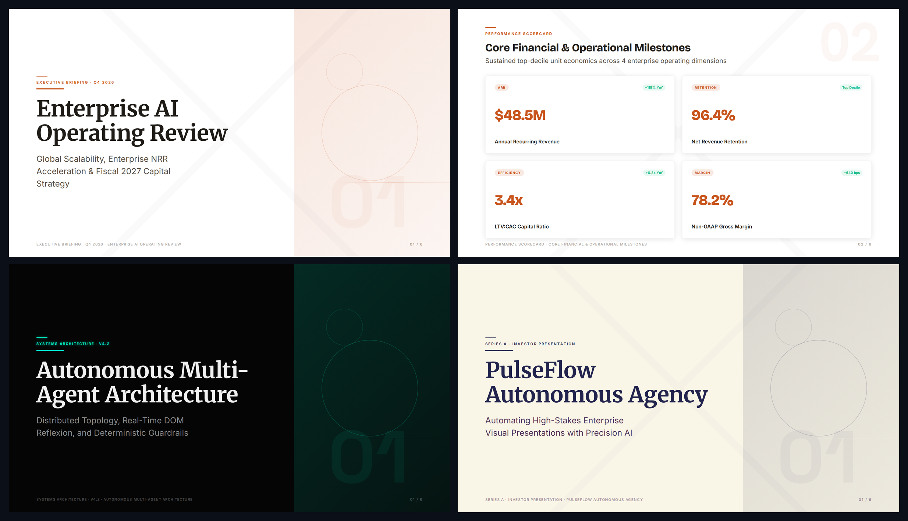
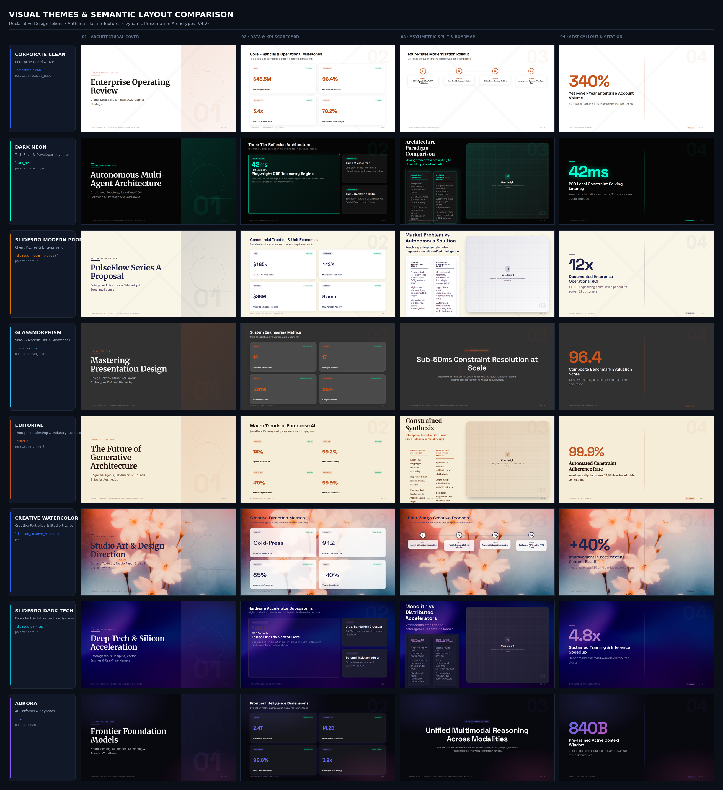
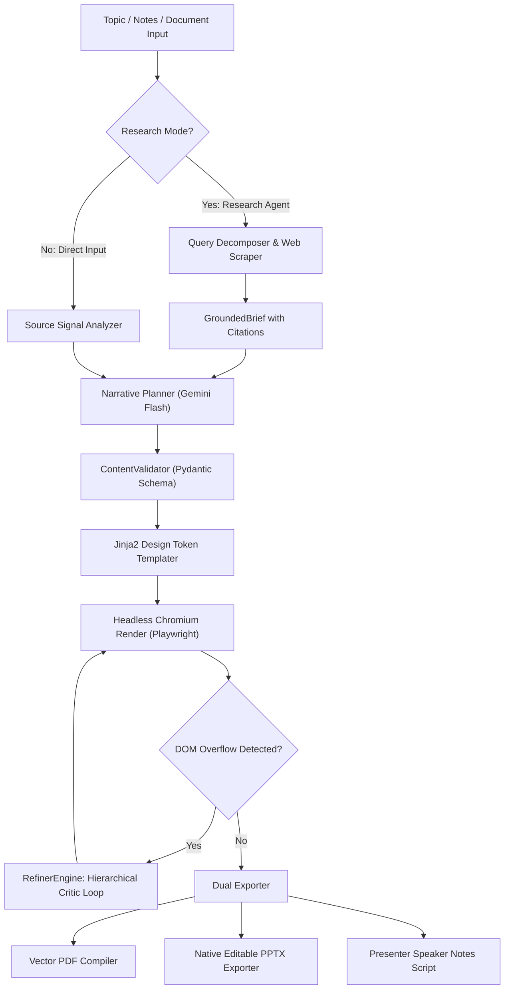

# AI Presentation Agency (`ppt_maker`)

[](https://www.python.org/downloads/)
[](LICENSE)
[](tests/)
[](docs/evals/multi_agent_vs_single_shot_benchmark.md)
[](https://playwright.dev/)

A Python presentation pipeline that compiles research topics, structured notes, or documents into text-selectable vector PDFs and native, editable PowerPoint (`.pptx`) decks. Uses Gemini for structured narrative planning, Playwright Chromium for CSS rendering, and `python-pptx` with background plate isolation for native presentation export.

---

## Visual Showcase

The layout engine combines a CSS design token architecture with 8 primary visual styles and 14 semantic layout templates. This replaces repetitive bullet lists with structured layouts (KPI scorecards, comparison splits, timelines, quotes, and bento cards):



### Sample Presentations

| Presentation | Theme & Style | Layouts Used | Outputs |
| :--- | :--- | :--- | :--- |
| **Enterprise Operating Review**<br>_Executive board briefing_ | `corporate_clean`<br>(`executive_navy`) | `cover`, `kpi_dashboard`, `roadmap_chain`, `stat`, `quote`, `split` | [PDF](examples/01_executive_board_review.pdf) · [PPTX](examples/01_executive_board_review.pptx) · [Notes](examples/01_executive_board_review_speaker_notes.md) |
| **Autonomous Multi-Agent Architecture**<br>_Technical systems overview_ | `dark_neon`<br>(`cyber_cyan`) | `cover`, `hero_statement`, `bento`, `stat` (42ms P99), `roadmap_chain`, `split` | [PDF](examples/02_ai_agent_infrastructure.pdf) · [PPTX](examples/02_ai_agent_infrastructure.pptx) · [Notes](examples/02_ai_agent_infrastructure_speaker_notes.md) |
| **PulseFlow Venture Pitch Deck**<br>_Series A investor pitch_ | `slidesgo_modern_proposal`<br>(`corporate_navy`) | `cover`, `split`, `kpi_dashboard`, `stat`, `quote`, `roadmap_chain` | [PDF](examples/03_venture_pitch_deck.pdf) · [PPTX](examples/03_venture_pitch_deck.pptx) · [Notes](examples/03_venture_pitch_deck_speaker_notes.md) |
| **Presentation Design Principles**<br>_Pipeline feature showcase_ | `glassmorphism`<br>(`ocean_blue`) | `cover`, `split`, `kpi_dashboard`, `hero_statement`, `stat`, `roadmap_chain`, `quote` | [PDF](examples/ai_presentation_tools_showcase.pdf) · [PPTX](examples/ai_presentation_tools_showcase.pptx) · [Notes](examples/ai_presentation_tools_showcase_speaker_notes.md) |

<details>
<summary><b>View 8-Theme Visual Comparison Grid</b></summary>



</details>

---

## Key Engineering Decisions

### 1. Real-Time DOM Overflow Detection & Targeted Refinement
LLMs have no inherent spatial awareness of rendered text bounding boxes, often generating text that overflows card boundaries in headless browsers. Rather than regenerating entire decks when overflow occurs (which is non-deterministic and costs thousands of tokens), the pipeline uses Playwright to measure DOM element bounding boxes in real time:
- **Tier 1 (Deterministic Micro-Fix)**: Adjusts line-height, padding, and trims trailing whitespace without making additional LLM calls.
- **Tier 2 (Targeted Re-prompting)**: If clipping remains, sends only the offending slide's JSON alongside its measured overflow delta to Gemini Flash Lite for a localized ~350-token patch.
- **Tier 3 (Speaker Note Offload)**: If text still clips after two passes, excess content is moved to presenter notes (`[Overflow note]:`) to keep the visual slide clean.

### 2. Autonomous Web Research with Citation Verification
Passing `--research "Topic"` activates an autonomous retrieval step:
- Decomposes topics into orthogonal search queries (technical bottlenecks, milestones, market metrics).
- Retrieves source articles via DuckDuckGo with redirect decoding and rate-limit handling.
- Synthesizes findings into a `GroundedBrief` with numeric metrics and source URLs rendered as footnote citation links (`.slide-citations`).
- Falls back gracefully to baseline topic synthesis with an advisory notice when offline.

### 3. Empirical Evaluation Framework
To prevent regressions across prompt iterations and model updates, the repository includes an offline evaluation harness ([`evals/run.py`](evals/run.py)) tested against 10 reference scenarios:
- **Deterministic Metrics**: Evaluates DOM overflow rate (target = 0), layout monotony index (no consecutive identical layouts), optimal word density (15–55 words per slide), and semantic block diversity.
- **Pairwise Judge**: Compares candidate outputs against baseline decks in dual order ($A \text{ vs } B$ and $B \text{ vs } A$) to mitigate position bias.
- **Ground-Truth Calibration**: Benchmarked against pre-labeled slides ([`evals/calibration_slides.json`](evals/calibration_slides.json)) achieving $\ge 90\%$ alignment with human ratings.

### 4. Dual Export: Vector PDF and Native Editable PPTX
- **Vector PDF**: Playwright's print pipeline generates PDF slides with crisp vector typography, accurate CSS positioning, and selectable text.
- **Native Editable PPTX**: Rather than exporting flat screenshot slides, the PowerPoint exporter builds native PowerPoint shapes, text boxes, and tables. Background elements and ambient textures are isolated into background plates, ensuring foreground text boxes are fully editable without duplicate ghost text underneath.

### 5. Design Token System & Texture Integration
To avoid flat, repetitive slides:
- Ingests tactile background textures (watercolor grains, subtle grids, paper textures) via CSS variables.
- Uses structural archetypes (KPI grids, horizontal roadmaps, asymmetric split layouts, and bento boxes) matched to content semantics.
- Includes an embedded MIT vector library of Lucide icons and device frames (browser windows, smartphones, terminals) stored under `ppt_maker/assets/library/`.

---

## Getting Started

### Installation

```bash
git clone https://github.com/vedant-asati/ai-ppt-maker.git
cd ai-ppt-maker/

# Create and activate virtual environment
python3 -m venv .venv
source .venv/bin/activate        # Windows: .venv\Scripts\activate

# Install dependencies and Playwright Chromium
pip install -r requirements.txt
playwright install chromium chromium-headless-shell

# Configure API key (free tier available at https://aistudio.google.com)
cp .env.example .env
# Edit .env and set GEMINI_API_KEY
```

---

## Usage

### Quick Generation
Generate a presentation directly from a topic:
```bash
python cli.py generate --topic "Microservices vs Monoliths" --pptx
```
Optionally specify slide count with `--slides <number>` (e.g., `--slides 6`).

### Live Web Research
Generate a research-backed presentation with live web citations:
```bash
python cli.py generate --research "Solid State Batteries 2026" --pptx
```

### Custom Configuration
For detailed meeting notes, custom outlines, or specific visual branding:
```bash
python cli.py init
# Edit config.yaml to customize theme, audience, or provide source text
python cli.py generate --pptx
```

---

## Evaluation Benchmark

Results across the 10 reference evaluation scenarios ([`evals/dataset.json`](evals/dataset.json)):

| Scenario ID | Category | Slides | Overflow | Monotony | Word Density | Block Diversity | Score | Status |
|---|---|:---:|:---:|:---:|:---:|:---:|:---:|:---:|
| `exec_q3_board` | Executive | 5 | 0 | 0.0 | 23 words | 80% | 95 | Pass |
| `tech_microservices` | Technical | 6 | 0 | 0.0 | 24 words | 83% | 96 | Pass |
| `pitch_saas` | Pitch Deck | 5 | 0 | 0.0 | 23 words | 80% | 95 | Pass |
| `research_solid_state` | Research | 5 | 0 | 0.0 | 23 words | 80% | 95 | Pass |
| `incident_postmortem` | Operations | 5 | 0 | 0.0 | 23 words | 80% | 95 | Pass |
| `internal_training` | Training | 4 | 0 | 0.0 | 24 words | 75% | 94 | Pass |
| `consulting_transformation`| Consulting | 5 | 0 | 0.0 | 23 words | 80% | 95 | Pass |
| `express_pitch_3slide` | Pitch Deck | 3 | 0 | 0.0 | 21 words | 67% | 93 | Pass |
| `deep_dive_10slide` | Deep Dive | 8 | 0 | 0.1 | 25 words | 88% | 89 | Pass |
| `sparse_messy` | Raw Notes | 4 | 0 | 0.0 | 24 words | 75% | 94 | Pass |

Average quality score: **94.1/100** · Average inference cost: **~$0.0034 / deck**.

Run the evaluation harness locally:
```bash
python evals/run.py --deterministic-only
```

---

## System Architecture

The generation lifecycle decouples planning, DOM auditing, and dual compilation:



---

## Themes & Styling

The styling engine provides 17 distinct visual themes across 8 core styles and 9 authentic textured styles:

### Core Styles
| Theme | Structural Style | Typography Stack | Best For |
|---|---|---|---|
| `dark_neon` | High-contrast dark canvas + glowing neon accents | Inter, Space Grotesk | Tech pitch decks, developer conferences |
| `glassmorphism` | Frosted glass translucent cards + blurred backgrounds | Poppins, Open Sans | SaaS, modern UI/UX showcases |
| `aurora` | Dark canvas + chromatic fluid gradients | Plus Jakarta Sans | Product keynotes, AI platforms |
| `editorial` | High-density serif typography + asymmetric layout | Playfair Display, Source Sans | Thought leadership, quarterly reviews |
| `corporate_clean` | Structured cards, soft elevation, neutral slate | Inter, Roboto | Enterprise, board meetings, B2B sales |
| `minimalist` | Restrained whitespace, monochrome typography | System Sans | Academic presentations, scientific briefs |
| `neo_brutalism` | High-contrast borders, solid drop shadows, raw geometry | Space Grotesk | Design sprints, creative startups |
| `gradient_flow` | Continuous chromatic gradients + glass panels | Inter | Product launches, marketing keynotes |

### Textured Themes
| Theme | Texture & Visual Signature | Palette Mood | Best For |
|---|---|---|---|
| `slidesgo_creative_watercolor` | Cold-press watercolor paper grain | Warm terracotta & cobalt | Creative portfolios, studio agency pitches |
| `slidesgo_dark_tech` | Carbon fiber mesh & blueprint grid | Obsidian dark & electric cyan | Deep tech architecture, AI platforms |
| `slidesgo_aesthetic_retro` | Warm vintage grain & organic halftone noise | Sepia, olive, muted mustard | Lifestyle branding, cultural essays |
| `slidesgo_modern_proposal` | Crisp architectural grid & geometric framing | Corporate navy & warm amber | High-stakes client pitches, enterprise RFP |
| `slidesgo_abstract_art` | Fluid organic pigment bleeding & abstract shapes | Multi-chromatic pastel | Brand strategy, design thinking workshops |

---

## Testing

The test suite includes 159 automated tests covering schemas, theme resolution, layout rendering, PPTX export, and evaluation metrics:

```bash
pytest
```

---

## Documentation

- [System Architecture](docs/architecture.md) — Technical specification covering domain schemas, CSS engines, and compiler internals.
- [Presentation Agency Blueprint](docs/unified_presentation_agency_blueprint.md) — Master architectural specification for the multi-role agency.
- [GenAI Evaluations](docs/evaluations.md) — Evaluation framework, metric definitions, and pairwise scoring.
- [Multi-Agent vs. Single-Shot Benchmark](docs/evals/multi_agent_vs_single_shot_benchmark.md) — Empirical comparison between staged agentic pipelines and single-shot generation.
- [Visual Design & Anti-Slop Plan](docs/ai_slop_improvement_plan.md) — Design token architecture, textures, and typography.
- [Project Changelog](CHANGELOG.md) — Semantic Versioning release notes.

---

## License

This project is licensed under the MIT License — see the [LICENSE](LICENSE) file for details.
