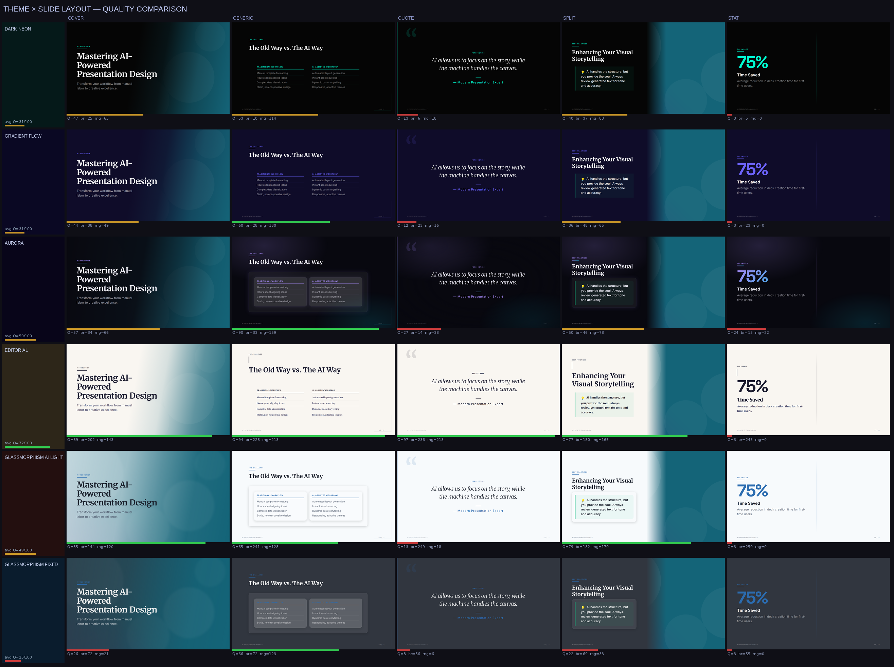
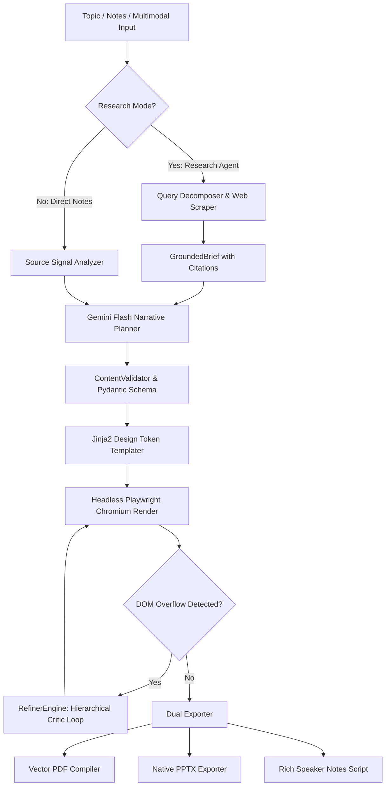

# AI Presentation Agency (`ppt_maker`)

[](https://www.python.org/downloads/)
[](LICENSE)
[](tests/)
[-success.svg)](docs/evaluations.md)
[](https://ai.google.dev/)
[](https://playwright.dev/)

An autonomous, multi-stage agentic presentation pipeline that synthesizes studio-grade presentations from high-level topics, raw research notes, or multimodal files. Compiles into text-selectable **vector PDFs** and native, fully editable **PowerPoint (`.pptx`) decks**.

---

## 🖼️ Visual Showcase

The pipeline features a unified CSS variable design token architecture with **8 distinct visual themes** and **7 semantic layout templates**, replacing generic bullet-point presentations with intentional typography, narrative hierarchy, and depth:



> 💡 **Sample Outputs**: Explore canonical sample presentations in the [`examples/`](examples/) directory:
> - 📄 **[Vector PDF Showcase](examples/ai_presentation_tools_showcase.pdf)** (Vector text, printable, responsive typography)
> - 📊 **[Editable PPTX Showcase](examples/ai_presentation_tools_showcase.pptx)** (Native PowerPoint shapes, isolated plates, speaker notes)
> - 📝 **[Presenter Notes Script](examples/ai_presentation_tools_showcase_speaker_notes.md)** (Transition cues & talk tracks)

---

## ⚡ Core Engineering Highlights

Unlike basic LLM prompt wrappers, `ai-ppt-maker` is built as an end-to-end production AI system with closed-loop verification, empirical evaluation, and deterministic safety guardrails:

### 1. 🔄 Targeted Agentic Refinement Loop (Closed-Loop Reflexion)
- **The Challenge**: LLMs lack visual spatial awareness, frequently causing text to overflow card boundaries or canvas viewports in headless Chromium. Full deck regeneration is slow, non-deterministic, and consumes ~6,000 tokens.
- **The Solution**: Playwright audits the DOM bounding boxes in real-time. If layout clipping is detected, [`RefinerEngine`](ppt_maker/planning/refiner.py) runs a hierarchical 3-tier critic-actor resolution:
  - **Tier 1 (Deterministic Micro-Fix)**: Clamps margin padding, prunes trailing whitespace, and adjusts line-height at 0ms latency and $0 cost.
  - **Tier 2 (Targeted Reflexion Patch)**: Sends the single-slide JSON + Playwright DOM coordinates to Gemini Flash Lite, applying surgical ~350-token patches.
  - **Tier 3 (Algorithmic Speaker Note Offload)**: If clipping persists after two passes, excess text is algorithmically preserved in presenter speaker notes (`[Overflow note]:`).

### 2. 🌐 Grounded Autonomous Research Agent
- **The Challenge**: Users often have a topic but lack pre-synthesized notes or metrics.
- **The Solution**: Pass `--research "Topic"` to trigger an autonomous research sub-pipeline:
  - **Query Decomposition**: Splits topics into 3 orthogonal research vectors (milestones, technical bottlenecks, market metrics).
  - **Zero-Key Web Retrieval**: Scrapes live articles via DuckDuckGo with exponential backoff and redirect decoding.
  - **GroundedBrief Synthesis**: Cleans boilerplate, extracts verified quantitative metrics, and generates presentations with clickable `.slide-citations` footnote links.
  - **Offline Resilience**: Automatically falls back to baseline knowledge with a visible advisory disclaimer if offline.

### 3. 🔬 Empirical GenAI Evaluation Framework & LLM-as-a-Judge
- **The Challenge**: Prompt changes, CSS tweaks, or model migrations (e.g. Gemini 2.5 Flash $\rightarrow$ 3.1 Flash Lite) risk silent regressions in monotony, wordiness, and cost.
- **The Solution**: Built-in offline evaluation harness ([`evals/run.py`](evals/run.py)) benchmarking decks across 10 golden scenarios:
  - **4 Deterministic Metrics**: Computes DOM overflow rate, layout monotony index, optimal word density (15–55 words), and structured block diversity.
  - **Position-Bias Mitigated Pairwise Judge**: Evaluates candidates in dual order ($A \text{ vs } B$ and $B \text{ vs } A$) to reject position bias.
  - **Calibrated Ground Truth**: Benchmarked against pre-labeled slides ([`evals/calibration_slides.json`](evals/calibration_slides.json)) achieving $\ge 90\%$ agreement with human ground truth.

### 4. 📐 Dual-Target Vector PDF & Native Editable PPTX Compilation
- **Vector PDF Engine**: Leverages Playwright's headless Chromium print pipeline for pixel-perfect CSS rendering, subpixel font smoothing, and selectable vector typography.
- **PowerPoint Isolation Engine**: Generates `.pptx` decks using `python-pptx`. Employs background plate isolation to eliminate text duplication between background image renders and editable PowerPoint text boxes.

---

## 🚀 Quick Start

### 1. Installation

```bash
git clone https://github.com/vedant-asati/ai-ppt-maker.git
cd ai-ppt-maker/

# Create and activate virtual environment
python3 -m venv .venv
source .venv/bin/activate        # Windows: .venv\Scripts\activate

# Install dependencies and Playwright Chromium
pip install -r requirements.txt
playwright install chromium

# Configure your Gemini API key (free tier available at https://aistudio.google.com)
cp .env.example .env
# Edit .env and paste your GEMINI_API_KEY
```

---

## 🎯 How to Generate: Choose Your Path

```
┌─────────────────────────────────────────────────────────────────────────────────┐
│ 1. Instant One-Liner (Fastest)                                                  │
│    python cli.py generate --topic "Future of Quantum Computing" --pptx          │
│    → No config file required. Synthesizes a themed PDF + editable PPTX.         │
├─────────────────────────────────────────────────────────────────────────────────┤
│ 2. Live Web Research (Current Facts & Footnote Citations)                       │
│    python cli.py generate --research "Solid State Batteries 2026" --pptx        │
│    → Autonomous web research, quantitative metric extraction, and source links. │
├─────────────────────────────────────────────────────────────────────────────────┤
│ 3. Custom Config File (Full Fine-Tuning)                                        │
│    python cli.py init  &&  python cli.py generate --pptx                        │
│    → Fine-tune theme, palette, narrative arc, or provide extensive notes.       │
└─────────────────────────────────────────────────────────────────────────────────┘
```

### Path 1: Instant One-Liner
Pass your topic directly via terminal:
```bash
python cli.py generate --topic "Microservices vs Monoliths" --pptx
```
> 💡 Add `--slides 6` to enforce an exact slide count (supports 3–20 slides).

### Path 2: Autonomous Web Research
Let the research agent gather live web facts and citations:
```bash
python cli.py generate --research "Commercial Viability of Fusion Energy in 2026" --pptx
```

### Path 3: Fine-Tuning with `config.yaml`
Best for comprehensive meeting notes, custom outlines, or specific visual branding:
```bash
python cli.py init
# Edit config.yaml: paste notes, select theme (e.g. dark_neon), set audience (e.g. executive)
python cli.py generate --pptx
```

---

## 📊 Evaluation Scorecard (Golden Dataset)

Benchmark performance across the 10 production evaluation scenarios ([`evals/dataset.json`](evals/dataset.json)):

| Scenario ID | Category | Slides | Overflow | Monotony | Word Density | Block Diversity | Score | Grade | Status |
|---|---|:---:|:---:|:---:|:---:|:---:|:---:|:---:|:---:|
| `exec_q3_board` | Executive | 5 | 0 | 0.0 | 23 words | 80% | 95 | A | **PASS** |
| `tech_microservices` | Technical | 6 | 0 | 0.0 | 24 words | 83% | 96 | A | **PASS** |
| `pitch_saas` | Pitch Deck | 5 | 0 | 0.0 | 23 words | 80% | 95 | A | **PASS** |
| `research_solid_state` | Research | 5 | 0 | 0.0 | 23 words | 80% | 95 | A | **PASS** |
| `incident_postmortem` | Operations | 5 | 0 | 0.0 | 23 words | 80% | 95 | A | **PASS** |
| `internal_training` | Training | 4 | 0 | 0.0 | 24 words | 75% | 94 | A | **PASS** |
| `consulting_transformation`| Consulting | 5 | 0 | 0.0 | 23 words | 80% | 95 | A | **PASS** |
| `express_pitch_3slide` | Pitch Deck | 3 | 0 | 0.0 | 21 words | 67% | 93 | A | **PASS** |
| `deep_dive_10slide` | Deep Dive | 8 | 0 | 0.1 | 25 words | 88% | 89 | B | **PASS** |
| `sparse_messy` | Raw Notes | 4 | 0 | 0.0 | 24 words | 75% | 94 | A | **PASS** |

**Aggregate Results**: **100% Pass Rate** · **Average Score: 94.1/100 (Grade A)** · **Avg. Inference Cost: $0.0034 / deck**

Run the evaluation suite locally:
```bash
python evals/run.py --deterministic-only
```

---

## 🏛️ Pipeline Architecture

The end-to-end generation lifecycle decouples planning, DOM auditing, and dual compilation:



---

## 🎨 Visual Themes & Design Tokens

| Theme | Structural Style | Typography Stack | Best For |
|---|---|---|---|
| `dark_neon` | High-contrast dark canvas + glowing neon accents | Inter, Space Grotesk | Tech pitch decks, developer conferences |
| `glassmorphism` | Frosted glass translucent cards + blurred backgrounds | Poppins, Open Sans | SaaS, modern UI/UX showcases |
| `aurora` | Dark canvas + ethereal chromatic fluid blobs | Plus Jakarta Sans | Luxury branding, visionary AI pitches |
| `editorial` | High-density serif typography + asymmetric layout | Playfair Display, Source Sans | Thought leadership, quarterly reviews |
| `corporate_clean` | Structured cards, soft elevation, neutral slate | Inter, Roboto | Enterprise, board meetings, B2B sales |
| `minimalist` | Restrained whitespace, monochrome typography | System Sans | Academic presentations, scientific briefs |
| `neo_brutalism` | High-contrast borders, solid drop shadows, raw geometry | Space Grotesk | Web3, creative startups, design sprints |
| `gradient_flow` | Continuous chromatic gradients + glass panels | Inter | Product launches, marketing keynotes |

---

## 🧪 Testing & Quality Assurance

The codebase includes **95 automated tests** covering unit schemas, edge cases, Playwright rendering, and GenAI pipeline integration:

```bash
# Run the full test suite
pytest

# Run tests with execution timings
pytest -v
```

---

## 📚 Documentation & Deep Dives

- **[System Architecture Specification](docs/architecture.md)** — Comprehensive technical specification covering domain schemas, CSS engines, and compiler internals.
- **[GenAI Evaluations & LLM Judge](docs/evaluations.md)** — Evaluation harness architecture, metrics formulation, and pairwise rubric.
- **[Project Changelog](CHANGELOG.md)** — Semantic Versioning release history and architectural progression.
- **[Code Review Audit #01](docs/reviews/code/01_code_review.md)** — 14-dimension architectural quality audit.

---

## 📄 License

This project is licensed under the MIT License — see the [LICENSE](LICENSE) file for details.
