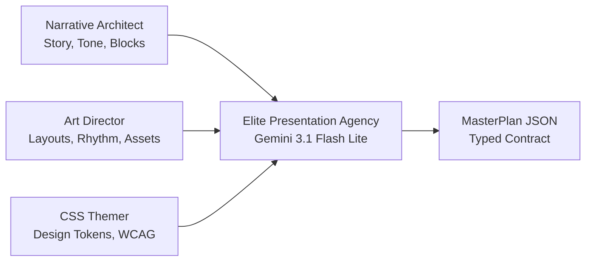
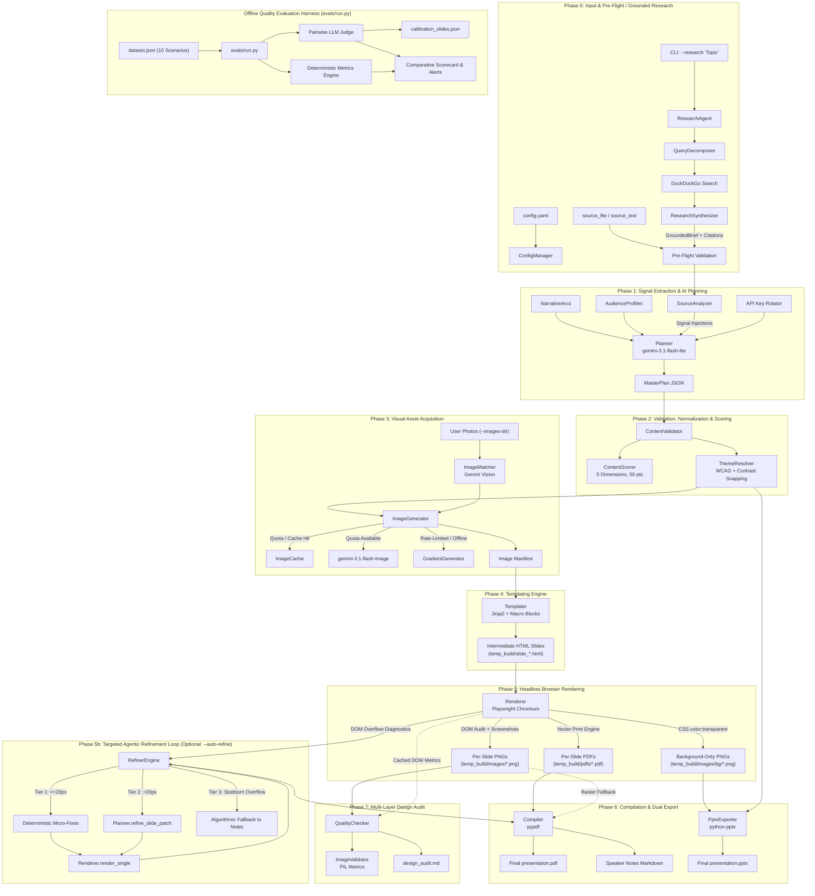
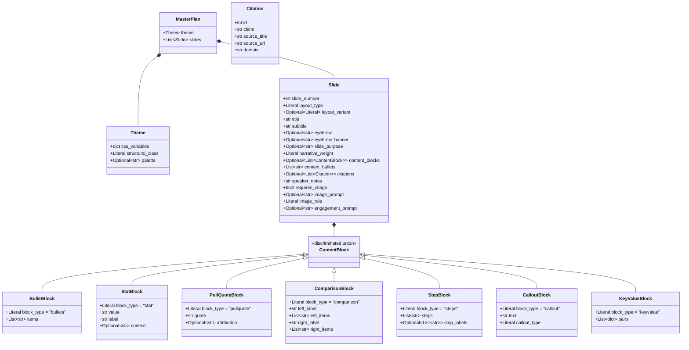
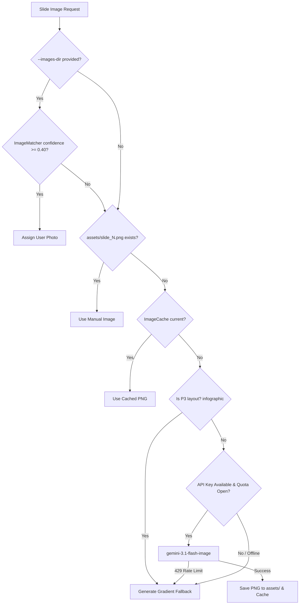
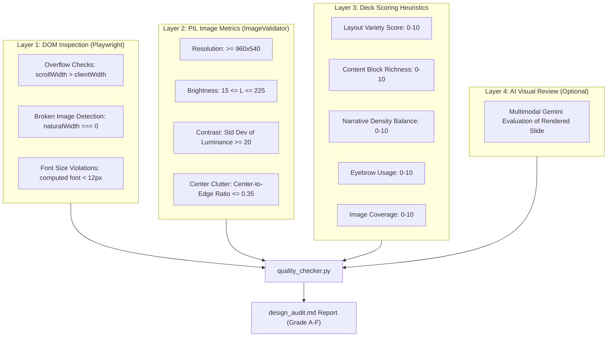

# AI Presentation Agency — Architecture Documentation

An autonomous, multi-stage presentation engineering pipeline that orchestrates Google Gemini models and Playwright headless browser rendering to synthesize studio-grade, themed presentations in text-selectable vector PDF and fully editable PPTX formats.

---

## Table of Contents

1. [Executive Summary & Core Philosophy](#1-executive-summary--core-philosophy)
2. [High-Level Architecture & End-to-End Pipeline](#2-high-level-architecture--end-to-end-pipeline)
3. [Domain Schemas & Data Model](#3-domain-schemas--data-model)
4. [Component Deep-Dive & Subsystems](#4-component-deep-dive--subsystems)
   - [4.1 CLI Orchestration & Configuration (`cli.py`, `config_manager.py`)](#41-cli-orchestration--configuration-clipy-config_managerpy)
   - [4.2 Pre-Planning Signal Analysis (`source_analyzer.py`)](#42-pre-planning-signal-analysis-source_analyzerpy)
   - [4.3 Narrative & Audience Engines (`narrative_arcs.py`, `audience_profiles.py`)](#43-narrative--audience-engines-narrative_arcspy-audience_profilespy)
   - [4.4 Master Planner & Agency Prompt (`planner.py`, `api_keys.py`)](#44-master-planner--agency-prompt-plannerpy-api_keyspy)
   - [4.5 Validation, Pruning & Scorer (`validator.py`, `content_scorer.py`)](#45-validation-pruning--scorer-validatorpy-content_scorerpy)
   - [4.6 Design System & Theme Resolver (`theme_palettes.py`, `theme_resolver.py`)](#46-design-system--theme-resolver-theme_palettespy-theme_resolverpy)
   - [4.7 Visual Asset Pipeline (`image_matcher.py`, `image_generator.py`, `image_cache.py`, `gradient_generator.py`)](#47-visual-asset-pipeline-image_matcherpy-image_generatorpy-image_cachepy-gradient_generatorpy)
   - [4.8 Templating Engine (`templater.py`, `templates/`)](#48-templating-engine-templaterpy-templates)
   - [4.9 Headless Rendering Engine (`renderer.py`, `font_downloader.py`)](#49-headless-rendering-engine-rendererpy-font_downloaderpy)
   - [4.10 Compilation & Dual Export (`compiler.py`, `pptx_exporter.py`)](#410-compilation--dual-export-compilerpy-pptx_exporterpy)
   - [4.11 Multi-Layer Design Quality Audit (`quality_checker.py`, `image_validator.py`)](#411-multi-layer-design-quality-audit-quality_checkerpy-image_validatorpy)
   - [4.12 Targeted Agentic Refinement Loop (`refiner.py`)](#412-targeted-agentic-refinement-loop-refinerpy)
   - [4.13 Grounded Research Agent (`research/agent.py`, `searcher.py`, `synthesizer.py`)](#413-grounded-research-agent-researchagentpy-searcherpy-synthesizerpy)
   - [4.14 GenAI Evaluation Framework (`evals/metrics.py`, `judge.py`, `run.py`)](#414-genai-evaluation-framework-evalsmetricspy-judgepy-runpy)
5. [Design System & Layout Architecture](#5-design-system--layout-architecture)
6. [Narrative & Prompt Engineering System](#6-narrative--prompt-engineering-system)
7. [Fault Tolerance, Quota Resilience & Offline Mode](#7-fault-tolerance-quota-resilience--offline-mode)
8. [Runtime Artifacts & Storage Lifecycle](#8-runtime-artifacts--storage-lifecycle)
9. [Modular Package Architecture & Codebase Layout](#9-modular-package-architecture--codebase-layout)

---

## 1. Executive Summary & Core Philosophy

Traditional AI presentation tools generate flat, repetitive bullet points stamped onto generic slide canvases. **AI Presentation Agency** is designed around the metaphor of a boutique presentation design firm comprising three synchronized roles:

1. **The Narrative Architect**: Synthesizes unstructured raw inputs into structured dramatic tension using proven storytelling arcs, audience-specific registers, and single-idea-per-slide discipline.
2. **The Art Director**: Determines layout spatial balance, visual breathing room, image role categorization, and hero data placements.
3. **The CSS Themer**: Establishes mathematically sound color harmonies, WCAG contrast compliance, type scales, and structural CSS tokens.



### Core Design Invariants

- **Text Selectability & Quality**: Generates native vector PDFs via Chromium's printing engine preserving backdrop filters, glassmorphism, and gradients without rasterizing text.
- **Editable PPTX Export**: Implements a clean dual-layer architecture: background aesthetics rendered to a single canvas backing, overlaid with native, fully editable PowerPoint text frames.
- **Content Blocks over Flat Strings**: Replaces generic string bullet lists with typed schema blocks (`StatBlock`, `PullQuoteBlock`, `ComparisonBlock`, `StepBlock`, `CalloutBlock`, `KeyValueBlock`).
- **Zero-Tolerance for Visual Monotony**: Strict rules prevent consecutive layout repeats, enforce narrative breathing room slides, and dynamically adjust visual variety according to deck length.

---

## 2. High-Level Architecture & End-to-End Pipeline

The system operates as a deterministic, multi-stage pipeline:



---

## 3. Domain Schemas & Data Model

The domain models defined in [`ppt_maker/core/schemas.py`](file:///home/intruder-jsr/exps/ai-ppt-maker/ppt_maker/core/schemas.py) establish a strict contract for the entire pipeline, using Pydantic V2 with discriminated unions.



### ContentBlock Discriminated Union

`ContentBlock` is implemented using Pydantic's `Annotated[Union[...], Field(discriminator='block_type')]`:

| Block Type | Purpose | Schema Key Fields | Visual Representation |
|---|---|---|---|
| `bullets` | Concise lists (max 5) | `items: List[str]` | Themed bullet list with accent markers |
| `stat` | Hero metric callout | `value: str`, `label: str`, `context: str` | 96px/72px hero number with subtext |
| `pullquote` | High-impact quote | `quote: str`, `attribution: str` | Editorial quotation with decorative marks |
| `comparison` | Side-by-side contrast | `left_label`, `left_items`, `right_label`, `right_items` | Split columns (Before vs After) |
| `steps` | Sequential process | `steps: List[str]`, `step_labels: List[str]` | Numbered badges with step description cards |
| `callout` | Highlighted takeaway | `text: str`, `callout_type: insight/warning/tip/fact` | Translucent accent card with colored border |
| `keyvalue` | Specifications/tables | `pairs: List[{key, value}]` | Two-column clean key-value grid |

---

## 4. Component Deep-Dive & Subsystems

### 4.1 CLI Orchestration & Configuration (`cli.py`, `config_manager.py`)

- **File Location**: [`cli.py`](file:///home/intruder-jsr/exps/ai-ppt-maker/cli.py), [`ppt_maker/cli.py`](file:///home/intruder-jsr/exps/ai-ppt-maker/ppt_maker/cli.py), [`ppt_maker/core/config_manager.py`](file:///home/intruder-jsr/exps/ai-ppt-maker/ppt_maker/core/config_manager.py)
- **Role**: Command-line entry point, argument parsing, `.env` bootstrapping, pre-flight safety gates, and multi-phase pipeline dispatching.
- **Commands**:
  - `init`: Generates a standard starter `config.yaml`.
  - `generate`: Orchestrates the complete end-to-end pipeline. Supports flags:
    - `--dry-run`: Stops after Phase 2 and writes `master_plan.json` for human inspection/editing.
    - `--offline-plan <FILE>`: Bypasses Phase 1 & 2 AI planning, rendering existing JSON blueprints.
    - `--images-dir <DIR>`: Enables Gemini Vision multimodal image-to-slide matching.
    - `--pptx`: Generates an editable PowerPoint file alongside the PDF.
    - `--preview`: Renders 3 slides at half resolution (960×540) for rapid visual debugging.
    - `--audit [quick|full|ai]`: Runs automated design audits immediately post-generation.
    - `--score`: Evaluates per-slide content heuristics in real time.
    - `--force-images` / `--clean-images`: Controls asset caching.
  - `audit`: Standalone design audit tool targeting pre-rendered slide directories.
  - `fonts`: Downloads the 6 Google Fonts into `assets/fonts/` for fully offline rendering.
- **Fail-Fast Pre-Flight Validation**:
  - Checks if `source_text` or `source_file` is provided.
  - Verifies existence of referenced input files.
  - Detects if an API key is absent for short prompts (<200 chars) that mandate LLM generation.

### 4.2 Pre-Planning Signal Analysis (`source_analyzer.py`)

- **File Location**: [`ppt_maker/planning/source_analyzer.py`](file:///home/intruder-jsr/exps/ai-ppt-maker/ppt_maker/planning/source_analyzer.py)
- **Role**: Heuristic signal extraction on raw source text before invoking the LLM planner.
- **Logic & Patterns**:
  - **Statistical Extraction**: Regex scans for currency (`$2.3B`), percentages (`40%`), multipliers (`10x`), and large numbers (`10,000+`).
  - **Quote Detection**: Identifies quoted statements (20–250 chars) for `PullQuoteBlock` placement.
  - **Sequential Steps**: Flags numbered lists and transition words (`first`, `phase 1`, `step 2`).
  - **Comparative Indicators**: Captures contrast vocabulary (`versus`, `vs`, `compared to`, `traditional`).
  - **Slide Count Heuristic**: Computes recommended slide count based on word count:
    $$\text{estimated\_slides} = \max\left(5, \min\left(15, \left\lfloor\frac{\text{word\_count}}{120}\right\rfloor\right)\right)$$
- **Impact**: Injected as `=== SOURCE PRE-ANALYSIS ===` into the Planner's prompt, preventing hallucinated numbers and anchoring the planner directly to empirical facts in the source.

### 4.3 Narrative & Audience Engines (`narrative_arcs.py`, `audience_profiles.py`)

- **File Locations**: [`ppt_maker/planning/narrative_arcs.py`](file:///home/intruder-jsr/exps/ai-ppt-maker/ppt_maker/planning/narrative_arcs.py), [`ppt_maker/planning/audience_profiles.py`](file:///home/intruder-jsr/exps/ai-ppt-maker/ppt_maker/planning/audience_profiles.py)
- **Narrative Arcs**: 7 structural blueprints defining the emotional and logical progression of slides:
  1. `problem_solution`: Agitation $\rightarrow$ Evidence $\rightarrow$ Solution Hero Moment $\rightarrow$ Proof $\rightarrow$ CTA.
  2. `before_after`: Current Pain $\rightarrow$ Turning Point $\rightarrow$ Transformed Future $\rightarrow$ Process.
  3. `what_why_how`: Orient $\rightarrow$ Motivate $\rightarrow$ Technical Execution.
  4. `journey`: Chronological story through obstacles, breakthrough, and lessons.
  5. `contrast`: Side-by-side alternative analysis, isolating the optimal path.
  6. `inverted_pyramid`: Headline finding first $\rightarrow$ supporting layers of depth.
  7. `showcase`: Portfolio / product-first presentation with high visual presence.
- **Audience Profiles**: 5 communication registers tuning lexical choice, slide density, and block preferences:
  - `investor`: Low density, hard traction metrics (ARR, CAC, Moat), defensive Q&A notes.
  - `technical`: High density, architecture specs, benchmarks, trade-offs, code structures.
  - `executive`: Strategic impact, high-level ROI, risk mitigation, top-down conclusions.
  - `academic`: Empirical rigor, methodology, citations, statistical nuances.
  - `general`: Engaging narrative metaphors, accessible vocabulary, relatable examples.

### 4.4 Master Planner & Agency Prompt (`planner.py`, `api_keys.py`)

- **File Locations**: [`ppt_maker/planning/planner.py`](file:///home/intruder-jsr/exps/ai-ppt-maker/ppt_maker/planning/planner.py), [`ppt_maker/core/api_keys.py`](file:///home/intruder-jsr/exps/ai-ppt-maker/ppt_maker/core/api_keys.py)
- **Model**: `gemini-3.1-flash-lite` (via the modern `google-genai` SDK).
- **Multi-Modal Intake**: Multi-modal files (`.pdf`, `.mp3`, `.mp4`, `.png`, `.jpg`) are uploaded using the Gemini Files API (`client.files.upload`), bound to the prompt context, and cleanly unlinked post-planning.
- **Agency Prompt Architecture**:
  - Implements the 19 Golden Agency Rules.
  - **Scale-Aware Variety Rules**:
    - Decks $\le 7$ slides: No 3 consecutive same layouts; $\ge 3$ distinct layout types.
    - Decks 8–12 slides: No 2 consecutive same layouts; $\ge 5$ distinct layout types; $\ge 2$ light breathing-room slides.
    - Decks $\ge 13$ slides: $\ge 6$ distinct layouts; $\ge 3$ light slides; section grouping via eyebrow consistency.
  - **Layout Rhythm Guide**: Dynamically computes recommended position rhythm (Exposition $\rightarrow$ Impact $\rightarrow$ Deep Dive $\rightarrow$ Breathing $\rightarrow$ Synthesis $\rightarrow$ CTA).
- **Execution & Retry Loop**:
  - Validates JSON format and runs Pydantic instantiation (`MasterPlan(**plan_dict)`).
  - Rotates through available API keys (`GEMINI_API_KEY`, `GEMINI_API_KEY_2`, etc.) on 429 quota exhaustion.
  - Employs exponential backoff (15s, 30s, 60s) across up to 4 retries for transient errors.

### 4.5 Validation, Pruning & Scorer (`validator.py`, `content_scorer.py`)

- **File Locations**: [`ppt_maker/planning/validator.py`](file:///home/intruder-jsr/exps/ai-ppt-maker/ppt_maker/planning/validator.py), [`ppt_maker/planning/content_scorer.py`](file:///home/intruder-jsr/exps/ai-ppt-maker/ppt_maker/planning/content_scorer.py)
- **Deterministic Cleanup (`ContentValidator`)**:
  - Sorts and de-duplicates slide indices.
  - Enforces layout-aware bullet count limits (`cover: 0`, `split: 4`, `infographic: 3`, `generic: 6`, `timeline: 5`).
  - Truncates oversized titles, subtitles (>120 chars), and bullets (>200 chars).
  - Detects corporate buzzword filler (`"leverage"`, `"synergy"`, `"paradigm shift"`).
  - Automatically migrates legacy `content_bullets` into structured `BulletBlock` instances.
  - Guarantees visual coverage: content slides lacking images are updated to `requires_image = True` with layout-appropriate `image_role` (`panel`, `supporting`, `background`, `decorative`).
  - Synthesizes robust image prompts if the model left them empty or trivial.
- **Real-Time Quality Scoring (`ContentScorer`)**:
  - Evaluates 5 dimensions (10 pts each, total 50 pts):
    1. *Title Quality*: Action verbs, length limits, absence of filler words.
    2. *Content Substance*: Presence of concrete numbers, block variety, bullet counts.
    3. *Visual Intent*: Presence and detail depth of image prompts, layout match.
    4. *Metadata Completeness*: Eyebrow labels, slide purpose, narrative weight tags.
    5. *Speaker Notes Quality*: Word count (3–5 sentences), absence of duplicate slide copy.
  - Computes letter grade ($A+ \ge 94\%$, $A \ge 88\%$, $B \ge 75\%$, $C \ge 60\%$, $D \ge 45\%$, else $F$).

### 4.6 Design System & Theme Resolver (`theme_palettes.py`, `theme_resolver.py`)

- **File Locations**: [`ppt_maker/design/theme_palettes.py`](file:///home/intruder-jsr/exps/ai-ppt-maker/ppt_maker/design/theme_palettes.py), [`ppt_maker/design/theme_resolver.py`](file:///home/intruder-jsr/exps/ai-ppt-maker/ppt_maker/design/theme_resolver.py)
- **Resolution Priority Order**:
  1. *User Primary Color Override*: Explicit `--primary` hex from config.
  2. *Curated Named Palette*: Structural color definitions from `theme_palettes.py`.
  3. *AI-Generated CSS Variables*: Base colors synthesized by LLM CSS Themer.
- **Mathematical Color Science**:
  - **CIEDE2000-Approximated RGB Distance**: Used to snap user hex colors to the nearest curated palette:
    $$\Delta C = \sqrt{2\,\Delta R^2 + 4\,\Delta G^2 + 3\,\Delta B^2}$$
  - **WCAG 2.1 Luminance & Contrast**:
    $$L = 0.2126\,R_{\text{linear}} + 0.7152\,G_{\text{linear}} + 0.0722\,B_{\text{linear}}$$
    $$\text{Ratio} = \frac{L_1 + 0.05}{L_2 + 0.05}$$
  - Enforces minimum 3.0:1 contrast for editorial themes (auto-falling back to high-contrast palettes if violated).
  - Computes `*-rgb` comma-delimited triplets for CSS `rgba()` alpha transparency calculations.
  - Enforces dark mode on `glassmorphism`: detects light AI-generated backgrounds and darkens them to allow frosted-glass backdrop filters to be visible.

### 4.7 Visual Asset Pipeline (`image_matcher.py`, `image_generator.py`, `image_cache.py`, `gradient_generator.py`)

- **File Locations**:
  [`ppt_maker/imaging/image_matcher.py`](file:///home/intruder-jsr/exps/ai-ppt-maker/ppt_maker/imaging/image_matcher.py),
  [`ppt_maker/imaging/image_generator.py`](file:///home/intruder-jsr/exps/ai-ppt-maker/ppt_maker/imaging/image_generator.py),
  [`ppt_maker/imaging/image_cache.py`](file:///home/intruder-jsr/exps/ai-ppt-maker/ppt_maker/imaging/image_cache.py),
  [`ppt_maker/design/gradient_generator.py`](file:///home/intruder-jsr/exps/ai-ppt-maker/ppt_maker/design/gradient_generator.py)
- **Visual Asset Workflow**:



- **Smart Image Matching (`ImageMatcher`)**:
  - Sends all user photo thumbnails and all slide metadata in a **single multimodal API call** to Gemini Vision.
  - Scores topic relevance, composition, and layout suitability (e.g., wide landscapes for cover, isolated objects for split).
  - Falls back to offline PIL heuristics (aspect ratio, resolution, filename token overlap) if offline.
- **AI Image Generation (`ImageGenerator`)**:
  - Uses `gemini-3.1-flash-image`.
  - Implements an internal token-bucket rate limiter (`_RateLimiter`) with timestamp sliding windows.
  - Prioritizes generation by layout importance: P0 (`cover`, `split`) $\rightarrow$ P1 (`stat`, `quote`) $\rightarrow$ P2 (`timeline`, `generic`) $\rightarrow$ P3 (`infographic`).
  - Exports prompt manifest to `assets/image_prompts.txt` allowing free-tier users to generate images manually in Midjourney/ChatGPT/Gemini Web.
- **Procedural Gradients (`GradientGenerator`)**:
  - Renders 1920×1080 themed gradients via PIL. Supports linear angle shifts, radial glows, and noise grain textures matching the active palette.

### 4.8 Templating Engine (`templater.py`, `templates/`)

- **File Locations**: [`ppt_maker/rendering/templater.py`](file:///home/intruder-jsr/exps/ai-ppt-maker/ppt_maker/rendering/templater.py), [`ppt_maker/templates/`](file:///home/intruder-jsr/exps/ai-ppt-maker/ppt_maker/templates/)
- **Engine**: Jinja2 with strict auto-escaping enabled.
- **Template Hierarchy**:
  - `base.html`: Central layout host, Google/offline font imports, CSS reset, full custom property token cascade, and structural theme rules.
  - `_blocks.html`: Reusable Jinja macro library rendering each typed `ContentBlock`.
  - Layout Templates: `cover.html`, `split.html`, `generic.html`, `infographic.html`, `quote.html`, `stat.html`, `timeline.html`.
- **Dynamic Context Binding**:
  - Converts local asset paths to absolute `file://` URIs so Playwright handles images reliably regardless of directory execution roots.
  - Injects semantic card tone classes derived from `slide_purpose` (`tone-problem`, `tone-evidence`, `tone-action`) to alter card borders and accent hues dynamically per slide.

### 4.9 Headless Rendering Engine (`renderer.py`, `font_downloader.py`)

- **File Locations**: [`ppt_maker/rendering/renderer.py`](file:///home/intruder-jsr/exps/ai-ppt-maker/ppt_maker/rendering/renderer.py), [`ppt_maker/design/font_downloader.py`](file:///home/intruder-jsr/exps/ai-ppt-maker/ppt_maker/design/font_downloader.py)
- **Technology**: Playwright Python API running headless Chromium.
- **Three Specialized Rendering Pipelines**:
  1. `render_to_pdf(html_files)`:
     - Uses Chromium's native vector print engine (`page.pdf()`).
     - Explicit dimensions: 1920px $\times$ 1080px (16:9), zero margins, `print_background=True`.
     - Output: Individual vector PDF pages with selectable text and embedded fonts.
  2. `render_all(html_files, audit=True)`:
     - Viewport screenshotting (1920$\times$1080, or 960$\times$540 for `--preview`).
     - Injects `_DOM_AUDIT_JS` before capturing, measuring DOM overflow, broken images, and font violations.
     - Output: High-resolution PNGs for audit analysis and fallback compilation.
  3. `render_background_only(html_files)`:
     - Injects custom CSS:
       ```css
       body *, body *::before, body *::after {
           color: transparent !important;
           -webkit-text-fill-color: transparent !important;
           text-shadow: none !important;
       }
       ```
     - Output: Background-only PNGs retaining all gradients, glass panels, and visual decor without baked-in text, eliminating double-text rendering in PPTX overlays.
- **Offline Font Bundling (`font_downloader.py`)**:
  - Downloads WOFF2/TTF binaries for Inter, Space Grotesk, Merriweather, Playfair Display, DM Serif Display, and Noto Serif Devanagari into `assets/fonts/` with a generated `fonts.css`.

### 4.10 Compilation & Dual Export (`compiler.py`, `pptx_exporter.py`)

- **File Locations**: [`ppt_maker/export/compiler.py`](file:///home/intruder-jsr/exps/ai-ppt-maker/ppt_maker/export/compiler.py), [`ppt_maker/export/pptx_exporter.py`](file:///home/intruder-jsr/exps/ai-ppt-maker/ppt_maker/export/pptx_exporter.py)
- **Vector PDF Merging (`Compiler.merge_pdfs`)**:
  - Utilizes `pypdf.PdfWriter` to stitch per-slide vector PDFs into a single document.
  - Automatically falls back to Pillow raster stitching (`Compiler.compile_to_pdf`) if vector components fail.
  - Built-in write collision detection: if the destination file is open/locked by a PDF reader, it automatically saves to a versioned path (e.g. `presentation_v2.pdf`).
- **Speaker Notes Compilation (`Compiler.export_speaker_notes`)**:
  - Generates a standalone companion Markdown document containing slide thumbnails, slide purpose, presenter script, transition cues, and an appendix of all generative image prompts.
- **Editable PPTX Export (`PptxExporter`)**:
  - Standard 16:9 widescreen canvas ($13.333'' \times 7.5''$).
  - Places `bg_slide_NNN.png` as the slide background.
  - Overlays native PowerPoint text frames positioned via exact coordinate maps (`LAYOUT_POSITIONS`).
  - Sets font sizes, weights, and theme-derived colors (`RGBColor`) matching the CSS design tokens.
  - Attaches `slide.speaker_notes` directly to the PPTX slide notes section.

### 4.11 Multi-Layer Design Quality Audit (`quality_checker.py`, `image_validator.py`)

- **File Locations**: [`ppt_maker/audit/quality_checker.py`](file:///home/intruder-jsr/exps/ai-ppt-maker/ppt_maker/audit/quality_checker.py), [`ppt_maker/imaging/image_validator.py`](file:///home/intruder-jsr/exps/ai-ppt-maker/ppt_maker/imaging/image_validator.py)
- **Orchestrates a 4-Layer Inspection**:



### 4.12 Targeted Agentic Refinement Loop (`refiner.py`)

- **File Location**: [`ppt_maker/planning/refiner.py`](file:///home/intruder-jsr/exps/ai-ppt-maker/ppt_maker/planning/refiner.py)
- **Design Philosophy**: Rather than re-generating an entire 10-slide deck on minor visual defects (which costs ~6,000 tokens and risks semantic regressions on previously good slides), the RefinerEngine implements targeted, single-slide Critic-Actor reflexion:
  - **Surgical Canvas Isolation**: Utilizes `Templater.generate_single_slide_html()` and `Renderer.render_single()` to compile and audit a single slide canvas in isolation (~300ms).
  - **Tier 1 (Deterministic Micro-Fixes)**: If overflow is minor ($\le 20\text{px}$), bullet padding is trimmed, leading/trailing whitespace pruned, and length clamped with $0\text{ms}$ latency and $\$0$ token cost.
  - **Tier 2 (Targeted LLM Reflexion)**: If overflow is structural ($> 20\text{px}$), `Planner.refine_slide_patch()` sends the specific slide JSON along with Playwright DOM diagnostic warnings to Gemini 3.1 Flash Lite. The LLM returns a structured patch focusing on conciseness and conceptual distillation (~350 tokens).
  - **Tier 3 (Algorithmic Hard Clamp Fallback)**: If a stubborn slide fails to converge after 2 passes, `apply_algorithmic_fallback()` clamps bullets to 3 items and offloads the excess points into presenter speaker notes (`[Overflow note (preserved for presenter)]:`), guaranteeing a non-clipped presentation.

### 4.13 Grounded Research Agent (`research/agent.py`, `searcher.py`, `synthesizer.py`)

- **File Locations**:
  - Orchestrator: [`ppt_maker/research/agent.py`](file:///home/intruder-jsr/exps/ai-ppt-maker/ppt_maker/research/agent.py)
  - Search & Query Decomposition: [`ppt_maker/research/searcher.py`](file:///home/intruder-jsr/exps/ai-ppt-maker/ppt_maker/research/searcher.py)
  - Content Synthesis: [`ppt_maker/research/synthesizer.py`](file:///home/intruder-jsr/exps/ai-ppt-maker/ppt_maker/research/synthesizer.py)
- **Workflow**:
  1. **Query Decomposition**: `QueryDecomposer` splits a single user topic into 3 orthogonal search queries (milestones, architectural bottlenecks, and future market projections).
  2. **Zero-Key Web Retrieval**: `DuckDuckGoSearchProvider` retrieves verified sources with exponential backoff and URL redirect resolution without requiring proprietary third-party search API keys.
  3. **Content Extraction**: HTML boilerplate, navigation bars, and tracking scripts are stripped to leave clean article markdown.
  4. **Grounded Synthesis**: `ResearchSynthesizer` structures key facts into a `GroundedBrief`, ensuring claims link directly to verified domains (`nature.com`, `reuters.com`).
  5. **Footnote Badging**: Footnotes are styled via `.slide-citations` and `.citation-badge` in HTML and PDF templates.
  6. **Resilient Fallback**: If network search fails or is offline, the agent gracefully falls back to baseline model knowledge, injecting `eyebrow_banner="⚠️ AI Baseline Knowledge Synthesis"` on the cover slide.

### 4.14 GenAI Evaluation Framework (`evals/metrics.py`, `judge.py`, `run.py`)

- **File Locations**:
  - Deterministic Metrics: [`evals/metrics.py`](file:///home/intruder-jsr/exps/ai-ppt-maker/evals/metrics.py)
  - LLM-as-a-Judge: [`evals/judge.py`](file:///home/intruder-jsr/exps/ai-ppt-maker/evals/judge.py)
  - CLI Harness & Benchmarking: [`evals/run.py`](file:///home/intruder-jsr/exps/ai-ppt-maker/evals/run.py)
  - Golden Benchmark Dataset: [`evals/dataset.json`](file:///home/intruder-jsr/exps/ai-ppt-maker/evals/dataset.json)
  - Calibration Dataset: [`evals/calibration_slides.json`](file:///home/intruder-jsr/exps/ai-ppt-maker/evals/calibration_slides.json)
- **Multi-Dimensional Quality Dimensions**:
  - **DOM Overflow Rate (30% weight)**: Measures the percentage of slides with zero layout clipping.
  - **Layout Monotony Score (25% weight)**: Detects consecutive layout repetitions and repetitive triplet sequences.
  - **Word Density Score (25% weight)**: Rates slides on punchiness (optimal: 15–55 words per slide).
  - **Content Block Diversity (20% weight)**: Assesses utilization of structured schema blocks (`StatBlock`, `StepBlock`, etc.) versus plain string bullets.
  - **System Telemetry & Economics**: Computes P95 latency, tokens/sec throughput, and dollar cost using Gemini pricing tables.
- **Calibrated Pairwise Evaluation**:
  - Mitigates position bias by running pairwise evaluations in dual order (Candidate A vs Candidate B, then Candidate B vs Candidate A) and rejecting inconsistent verdicts.
  - Validated against pre-labeled ground truth calibration slides to guarantee $\ge 90\%$ agreement before judging new models.

---

## 5. Design System & Layout Architecture

### 8 Structural Themes

The pipeline decouples theme aesthetics from slide templates via structural CSS classes injected onto the `<body>` element:

| Theme | Structural Class | Typography Style | Key CSS Characteristics | Ideal Use Cases |
|---|---|---|---|---|
| **Minimalist** | `minimalist` | Inter / Sans-serif | 0px radius, sharp borders, pure whitespace, no shadows | Academic, scientific, research |
| **Glassmorphism** | `glassmorphism` | Inter / Space Grotesk | Translucent cards (`rgba(255,255,255,0.08)`), `backdrop-filter: blur(20px)` | Modern tech, SaaS, product demos |
| **Neo-Brutalism** | `neo_brutalism` | Space Grotesk | Hard black borders (`3px solid #000`), offset drop shadows (`5px 5px 0 #000`), bold badges | Startups, developer tooling, creative |
| **Corporate Clean** | `corporate_clean` | Inter | Soft rounded corners (12px), subtle box shadows (`0 4px 20px rgba(0,0,0,0.06)`), clean cards | Enterprise, B2B, executive boardrooms |
| **Dark Neon** | `dark_neon` | Space Grotesk | Deep black background (`#0A0A0F`), glowing border highlights (`box-shadow: 0 0 25px var(--primary)`), high contrast | Cyber, developer pitches, AI showcases |
| **Gradient Flow** | `gradient_flow` | Inter | Multi-stop angled background gradients, glassmorphism content containers | Marketing, product launches, consumer tech |
| **Editorial** | `editorial` | Playfair / DM Serif Display | Serif headlines, thin hairline rules (`1px solid`), high typographic hierarchy | Thought leadership, keynote essays |
| **Aurora** | `aurora` | Space Grotesk | Glowing radial gradient blobs with blurred blending over deep dark canvas | Luxury, AI concepts, creative brands |

### 7 Layout Templates

Each layout serves a dedicated spatial role, preventing one-size-fits-all slide fatigue:

```
1. cover          2. split (50/50)      3. generic (full width)
┌──────────────┐  ┌──────┬──────┐       ┌──────────────────────┐
│  [ Eyebrow ] │  │Text  │Image │       │ [ Eyebrow ] Title    │
│  HERO TITLE  │  │      │      │       │ ───────────────────  │
│  Subtitle    │  │      │      │       │ [ Content Panel    ] │
└──────────────┘  └──────┴──────┘       └──────────────────────┘

4. infographic    5. quote              6. stat
┌──────────────┐  ┌──────────────┐      ┌──────┬───────────────┐
│ [Card][Card] │  │      “       │      │ 400% │ Supporting    │
│ [Card]       │  │ Large Quote  │      │      │ Stats & Text  │
│              │  │ — Attribution│      │ HERO │               │
└──────────────┘  └──────────────┘      └──────┴───────────────┘

7. timeline
┌──────────────────────────────────────┐
│  Step 1  ───  Step 2  ───  Step 3    │
│  [Card]       [Card]       [Card]    │
└──────────────────────────────────────┘
```

---

## 6. Narrative & Prompt Engineering System

The Planner is guided by a 19-rule system prompt executing agency-grade editorial principles:

### Golden Rules Summary

1. **One Idea Per Slide**: Every slide communicates one single assertion.
2. **Lead with the Insight**: Avoid category labels (`"Market Growth"`); write conclusions (`"Market Expanded 3.4x in 24 Months"`).
3. **Active Verbs**: Titles must contain active verbs to drive momentum.
4. **Evidence First**: Quantified metrics take precedence over adjectives.
5. **Bullets as Last Resort**: Mandatory use of typed blocks (`stat`, `pullquote`, `comparison`, `steps`) before falling back to bullet points.
6. **Strict Bullet Caps**: Never exceed 5 bullets per slide; max 120 characters per bullet.
7. **No Corporate Filler**: Strict bans on filler phrases (`"in order to"`, `"synergy"`, `"moving forward"`).
8. **Specific Nouns**: Real entity names required instead of generic placeholders (`"the tool"`).
9. **Visual Breathing Room**: Intentional insertion of `narrative_weight = "light"` slides (single stat or quote).
10. **Eyebrow Context**: Categorical tags (`"Problem"`, `"Phase 2"`) placed above titles.
11. **Natural Speaker Notes**: 3–5 sentences providing verbal context rather than repeating slide text.
12. **Scale-Aware Variety**: Strict prohibitions on consecutive layout repeats.
13. **Detailed Image Prompts**: Prompts must contain Subject, Style, Palette, Composition, Detail, and Exclusion clauses.
14. **Layout-Specific Image Roles**: Assigns `panel` (right 37%), `supporting` (right 50%), `background` (full-bleed), or `decorative`.
15. **Engagement Prompts ("Mirror Moment")**: Content slides include a reflective audience question.

---

## 7. Fault Tolerance, Quota Resilience & Offline Mode

The system is designed to run reliably under strict API constraints or completely offline:

| Failure / Constraint Mode | Architectural Mitigation | Code Location |
|---|---|---|
| **API Rate Limit (HTTP 429)** | Auto-rotates to `GEMINI_API_KEY_2` through `_9`; backoff delay on single keys. | `ppt_maker/core/api_keys.py`, `ppt_maker/planning/planner.py` |
| **Image Generation Quota Outage** | Bypasses failed API calls and generates procedural PIL gradients matching active palette. Prompts exported to `assets/image_prompts.txt`. | `ppt_maker/imaging/image_generator.py`, `ppt_maker/design/gradient_generator.py` |
| **PDF Destination File Locked** | Catches `PermissionError` (when PDF is open in viewer) and automatically saves to versioned `*_v2.pdf`. | `ppt_maker/export/compiler.py` |
| **Completely Air-Gapped / Offline** | `--offline-plan <FILE>` skips LLM planning; local font bundle via `cli.py fonts`; PIL image matcher. | `cli.py`, `ppt_maker/design/font_downloader.py`, `ppt_maker/imaging/image_matcher.py` |
| **HTML Navigation Timeout** | Dual-tier Playwright wait: attempts `networkidle` (15s) with fallback to `domcontentloaded` (8s). | `ppt_maker/rendering/renderer.py` |
| **Malformed LLM Output** | Regex JSON fence stripping + JSON boundary detection (`_extract_json`) + Pydantic validation. | `ppt_maker/planning/planner.py` |
| **PPTX Double-Text Artifact** | CSS color transparency injection (`render_background_only`) isolates background design from text overlays. | `ppt_maker/rendering/renderer.py`, `ppt_maker/export/pptx_exporter.py` |

---

## 8. Runtime Artifacts & Storage Lifecycle

```
ai-ppt-maker/
├── config.yaml                    # Active user configuration
├── config_reference.yaml          # Read-only configuration reference
├── master_plan.json               # Canonical AI presentation blueprint
│
├── assets/                        # Persistent asset directory
│   ├── .image_cache.json          # Content-hash cache tracking generated images
│   ├── .image_match_cache.json    # Vision matching cache
│   ├── fonts/                     # Local Google Fonts bundle (offline mode)
│   │   ├── fonts.css              # @font-face declarations
│   │   └── *.woff2                # Font binary files
│   ├── image_prompts.txt          # Exported image prompts for manual generation
│   ├── slide_*.png                # Generated / matched slide images
│   └── placeholder.png            # Universal fallback graphic
│
├── temp_build/                    # Ephemeral build directory (auto-cleaned)
│   ├── slide_*.html               # Rendered Jinja2 HTML slides
│   ├── dom_audit.json             # Cached DOM inspection metrics
│   ├── images/                    # Screenshot slide PNGs
│   │   ├── slide_*.png            # Full rendered slide screenshots
│   │   └── bg/                    # Background-only PNGs (text transparent)
│   └── pdfs/                      # Individual vector PDF slides
│       └── slide_*.pdf
│
└── output/                        # Default export destination
    ├── presentation.pdf           # Vector searchable PDF presentation
    ├── presentation.pptx          # Editable PowerPoint presentation
    ├── presentation_speaker_notes.md # Speaker notes companion
    └── design_audit.md            # Quality audit report
```

### Build Lifecycle Cleanup
- `temp_build/images` is cleared at the start of each generation cycle to prevent stale slide screenshots from polluting compilation.
- Multi-modal files uploaded to Gemini are explicitly deleted from Google's servers (`client.files.delete`) immediately upon plan completion.

---

## 9. Modular Package Architecture & Codebase Layout

The codebase is organized as a clean, production-grade Python package (`ppt_maker`) with decoupled domain subpackages, standard packaging configuration (`pyproject.toml`), and backward-compatible root entrypoints.

```
ai-ppt-maker/
├── pyproject.toml                 # Standard PEP 517/621 package build configuration
├── requirements.txt               # Pinned direct project dependencies
├── cli.py                         # Root CLI entrypoint (delegates to ppt_maker.cli)
├── config.yaml                    # Active user configuration
├── master_plan.json               # Canonical active presentation blueprint
│
├── ppt_maker/                     # Core Python Package
│   ├── __init__.py                # Package root & high-level public API exports
│   ├── cli.py                     # Rich CLI interface (generate, audit, fonts, init)
│   │
│   ├── core/                      # Data models & configuration
│   │   ├── __init__.py
│   │   ├── schemas.py             # Pydantic V2 domain models & content blocks
│   │   ├── config_manager.py      # YAML config loader with validation & defaults
│   │   └── api_keys.py            # Multi-key rotation pool & quota handling
│   │
│   ├── planning/                  # Narrative structure, content scoring & validation
│   │   ├── __init__.py
│   │   ├── planner.py             # Gemini multimodal generation & few-shot prompts
│   │   ├── refiner.py             # Targeted agentic reflexion loop & DOM overflow patcher
│   │   ├── validator.py           # Integrity enforcement & auto-repair rules
│   │   ├── content_scorer.py      # Rubric scoring & slide grading engine
│   │   ├── source_analyzer.py     # Heuristic signal extractor & outline estimator
│   │   ├── narrative_arcs.py      # 7 proven storytelling dramatic structures
│   │   └── audience_profiles.py   # 5 audience register tone definitions
│   │
│   ├── research/                  # Autonomous web research & grounding agent
│   │   ├── __init__.py
│   │   ├── agent.py               # Multi-query research orchestrator & fallback handler
│   │   ├── searcher.py            # Query decomposition (3 angles) & DuckDuckGo search
│   │   └── synthesizer.py         # HTML cleaner, GroundedBrief & citation extraction
│   │
│   ├── design/                    # Visual styling, themes, palettes & typography
│   │   ├── __init__.py
│   │   ├── theme_resolver.py      # Dynamic CSS variable calculator & dark contrast guards
│   │   ├── theme_palettes.py      # Curated color palettes & brand archetypes
│   │   ├── gradient_generator.py  # Procedural PIL fallback backgrounds
│   │   └── font_downloader.py     # Local Google Fonts offline downloader
│   │
│   ├── imaging/                   # Image generation, vision matching & asset caching
│   │   ├── __init__.py
│   │   ├── image_generator.py     # Imagen API client & rate-limited orchestration
│   │   ├── image_matcher.py       # Gemini Vision semantic photo matcher
│   │   ├── image_cache.py         # Content-hash & theme-aware asset cache
│   │   └── image_validator.py     # PIL histogram & contrast quality analyzer
│   │
│   ├── rendering/                 # Template compilation & browser automation
│   │   ├── __init__.py
│   │   ├── templater.py           # Jinja2 environment, layouts & single-slide HTML
│   │   └── renderer.py            # Playwright headless Chromium runner & single-slide re-render
│   │
│   ├── export/                    # Multi-format publication engines
│   │   ├── __init__.py
│   │   ├── compiler.py            # Vector PDF merger & speaker notes markdown compiler
│   │   └── pptx_exporter.py       # Native PowerPoint generator with isolated backgrounds
│   │
│   ├── audit/                     # Design assurance & reporting
│   │   ├── __init__.py
│   │   └── quality_checker.py     # 3-layer audit pipeline (DOM, PIL, Rubric)
│   │
│   └── templates/                 # Jinja2 layout templates & CSS design system
│       ├── base.html              # Base HTML scaffolding & shared design system
│       ├── _blocks.html           # Reusable content block macros
│       ├── cover.html             # Hero cover slide layout
│       ├── split.html             # 50/50 visual split layout
│       ├── infographic.html       # 3-column feature grid layout
│       ├── timeline.html          # Sequential milestone process layout
│       ├── quote.html             # Editorial pull-quote layout
│       ├── stat.html              # Hero metric callout layout
│       └── generic.html           # Flexible full-width layout
│
├── evals/                         # GenAI Evaluation Harness & Benchmarking
│   ├── dataset.json               # 10 curated benchmark evaluation scenarios
│   ├── calibration_slides.json    # Pre-labeled ground-truth calibration dataset
│   ├── metrics.py                 # Deterministic metrics (overflow, monotony, density, cost)
│   ├── judge.py                   # Position-bias mitigated pairwise LLM-as-a-Judge
│   └── run.py                     # CLI evaluation runner & scorecard exporter
│
├── examples/                      # Showcase presentation artifacts & sample blueprints
│   ├── ai_presentation_tools_showcase.pdf
│   ├── ai_presentation_tools_showcase.pptx
│   ├── ai_presentation_tools_showcase_speaker_notes.md
│   ├── ai-ppt-maker-arch.pdf
│   ├── master_plan_patched.json
│   └── sample_master_plan.json
│
├── tests/                         # Automated test suites (96 tests, 100% passing)
│   ├── test_features.py           # Core feature verification suite (12 tests)
│   ├── test_advanced.py           # Edge case & pipeline integration suite (44 tests)
│   ├── test_evals.py              # Deterministic evals metrics suite (12 tests)
│   ├── test_refiner.py            # Targeted agentic refinement suite (8 tests)
│   ├── test_judge.py              # LLM judge & calibration suite (6 tests)
│   ├── test_research.py           # Grounded research agent suite (9 tests)
│   └── test_genai_e2e.py          # Consolidated end-to-end integration suite (5 tests)
│
└── docs/                          # Architectural and operational documentation
    ├── README.md                  # Central documentation index & navigation hub
    ├── architecture.md            # Complete system design & data flow specification
    ├── reviews/
    │   └── code/
    │       └── 01_code_review.md  # Architectural code review #01 (CR-01)
    ├── plans/
    │   ├── bug-fixing/
    │   │   └── 01_code_review_remediation.md # Correlated remediation plan (PLAN-01)
    │   ├── features/              # Feature design RFCs & subsystem plans
    │   └── roadmap/               # Strategic excellence roadmaps
    ├── issues/                    # Post-mortem defect analyses (ISS-001–010)
    ├── retrospectives/            # Session logs & milestone summaries
    └── reference/                 # Model API references & specs
```

