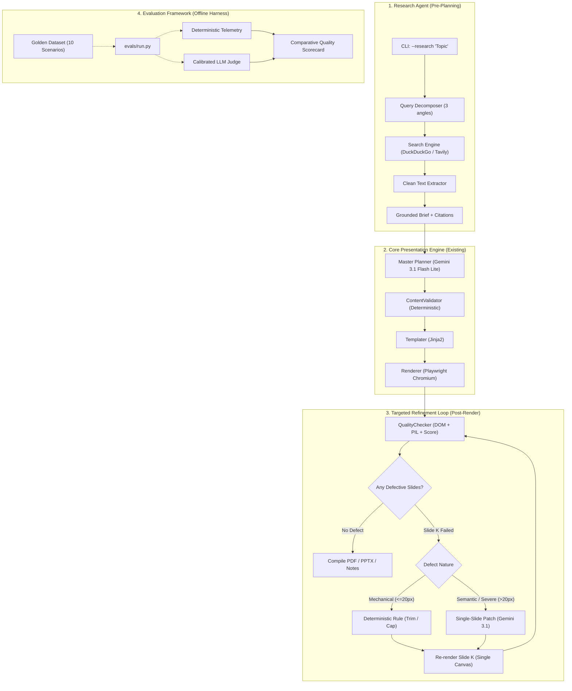
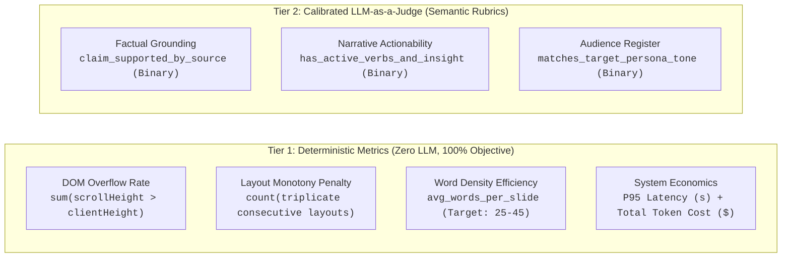
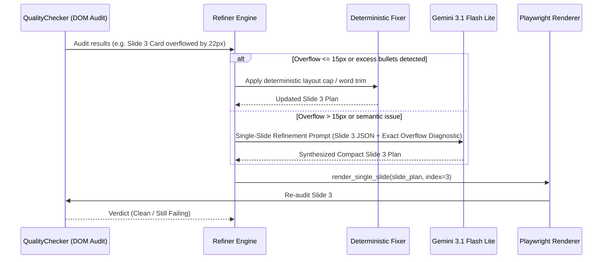
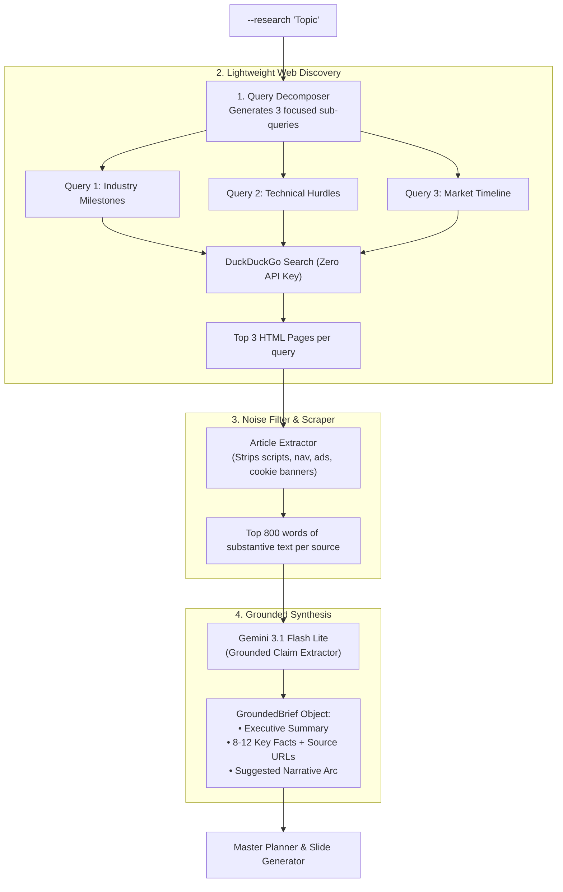
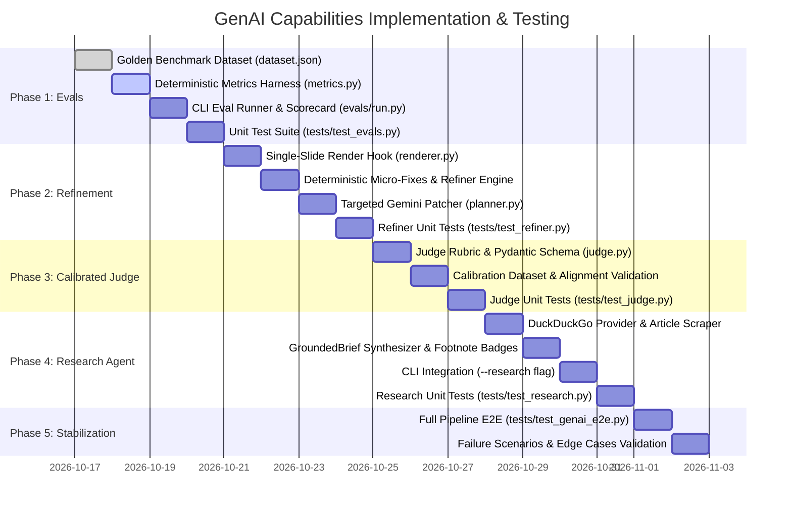
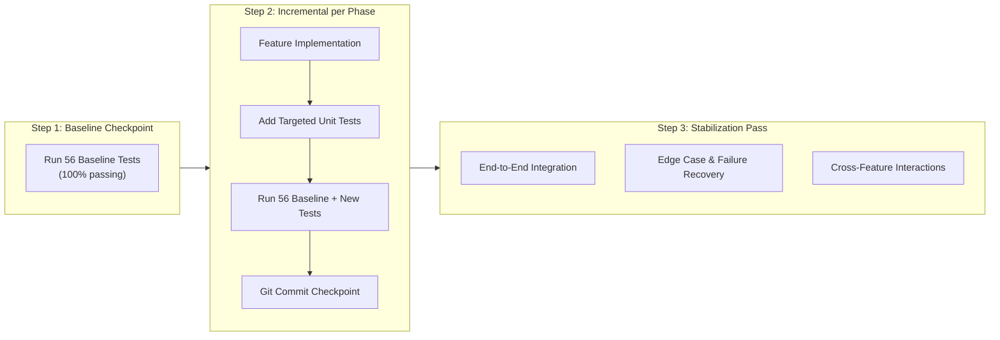

# GenAI Capabilities Plan: Evals, Targeted Refinement & Grounded Research

> [!NOTE]
> **Implementation Status: COMPLETE & PUSHED (100%)**
> All 5 phases are fully implemented, verified with 96 tests (56 baseline + 40 GenAI tests, 100% passing), and committed to `main`.
> - Phase 1 (`c83ed97`): Deterministic Evals Harness & Golden Benchmark
> - Phase 2 (`2b3238f`): Targeted Agentic Refinement Loop
> - Phase 3 (`f71fcc4`): Calibrated LLM-as-a-Judge & Position-Bias Mitigation
> - Phase 4 (`a20ef78`): Grounded Research Agent & Verified Citations
> - Phase 5 (`2e81f0d`): Post-Stabilization Integration & Edge-Case Pass

An architectural and implementation blueprint for extending **AI Presentation Agency** with three production GenAI capabilities:
1. **GenAI Evaluation Framework** (Deterministic metrics + Calibrated LLM-as-a-Judge)
2. **Targeted Agentic Refinement Loop** (Hybrid Deterministic + Selective Single-Slide LLM Reflexion)
3. **Grounded Research Agent** (Multi-query search, source synthesis, and verifiable footnote citations)

---

## 0. Executive Summary & Design Invariants

Modern generative AI applications frequently succumb to "resume-driven development": piling on vector databases, agent frameworks, and multi-round LLM debates where simple, typed, deterministic pipelines are faster, cheaper, and 100% reliable.

This plan enforces three strict architectural invariants:

1. **Deterministic Mechanics, Generative Semantics**:
   - Algorithms, CSS, and heuristics handle dimensions, DOM overflow limits, layout rules, contrast ratios, and syntax validation ($0\text{ms}$ latency, $\$0$ token cost).
   - LLMs handle semantic synthesis, creative re-conceptualization, audience register, and grounded reasoning.
2. **Zero Unnecessary Infrastructure**:
   - **No Vector Databases / Embedding Models**: A presentation deck needs 3–5 timely facts and structured narrative context, not semantic search across 10,000 chunks. Direct web extraction into Gemini's context window is simpler, cheaper, and more dependable.
   - **No Heavy Agent Frameworks (CrewAI, LangGraph, AutoGen)**: The existing codebase is clean, modular Python. A transparent, typed **Critic-Actor function** avoids opaque execution trees, high debugging overhead, and runaway token loops.
3. **Surgical, Single-Slide Mutations**:
   - If Slide 3 has an issue, **only Slide 3 is patched and re-rendered**. The other 9 slides remain completely untouched, keeping cost down to $\approx 300$ tokens and latency under $1.5\text{s}$.



---

## 1. Architectural & Engineering Rationale

This section formalizes the engineering thought process, user value justification, and the reasons why specific popular GenAI patterns were deliberately chosen or rejected.

### 1.1 The "Why": Genuine User Value vs. Resume-Driven Complexity

| Capability | Persona Benefiting | Concrete Problem Solved | Why It's High-Value Engineering |
| :--- | :--- | :--- | :--- |
| **Targeted Refinement Loop** | Executives, Sales, Presenters | **Eliminates manual PPTX edits for text clipping & card overflow.** In single-pass generation, any DOM overflow requires the user to open PowerPoint to manually delete words. | It's a closed-loop system using browser rendering telemetry (Playwright DOM metrics) to fix its own defects, turning a 90% deck into a 100% presentation-ready deck without human intervention. |
| **Grounded Research Agent** | Researchers, Tech Leads, Students | **Eliminates the "blank page" bottleneck.** Currently, the tool requires the user to already have extensive raw notes. Users cannot generate a deck from just an idea. | It provides real-time web retrieval, source verification, and cited provenance, converting a 1-sentence topic into a credible, cited deck without needing a pre-existing 10-page brief. |
| **GenAI Evaluation Suite** | Developers, Maintainers, Teams | **Prevents silent model & prompt regressions.** Changing prompts or models often silently breaks layouts, increases token spend, or introduces corporate fluff. | Without evals, prompt engineering is ungrounded guesswork. With evals, we have empirical Pareto frontiers (Quality vs. Latency vs. Cost) to validate every update. |

### 1.2 Architectural Alternatives Evaluated & Explicitly Rejected

To maintain a lean, robust codebase, we deliberately evaluated and rejected several industry "buzzword" patterns:

1. **Rejected: Vector Databases & Chunk Embeddings (ChromaDB, Pinecone, FAISS)**:
   - *Alternative Considered*: Ingest web pages, chunk them into 500-token vectors, embed them with text-embedding-004, store in a local ChromaDB, and run semantic similarity retrieval.
   - *Why Rejected*: A presentation deck needs 3–5 timely facts and structured narrative context, not semantic search across 10,000 document chunks. Modern LLMs (like Gemini 3.1 Flash Lite) have large context windows that can ingest clean text from 3–5 authoritative web sources directly. Adding a vector DB introduces native C++ compilation requirements, SQLite locking risks, chunking boundary bugs, and index storage overhead for zero user benefit.
2. **Rejected: Heavy Multi-Agent Frameworks (LangGraph, CrewAI, AutoGen)**:
   - *Alternative Considered*: Spin up autonomous agents with conversational message buses, tool registries, and inter-agent debate loops.
   - *Why Rejected*: Multi-agent frameworks introduce opaque execution trees, non-deterministic token loops, complex state serialization, and difficult debugging. A transparent, typed Python Critic-Actor function with strict iteration caps provides 100% determinism, millisecond-level execution, straightforward testability, and predictable costs.
3. **Rejected: Whole-Deck Regeneration for Slide-Level Flaws**:
   - *Alternative Considered*: If Slide 3 has an overflow, pass the audit warnings back into the planner to regenerate all 10 slides.
   - *Why Rejected*: Regenerating the whole deck burns $\approx 6,000$ tokens, takes $10\text{s}+$, and frequently introduces new defects into slides that were already visually perfect. A surgical single-slide patch costs $\approx 350$ tokens, executes in $\approx 1.2\text{s}$, and isolates mutations.
4. **Rejected: LLM-Only Mechanical Corrections**:
   - *Alternative Considered*: Asking an LLM to prune 10 words or enforce a 4-bullet layout cap.
   - *Why Rejected*: Calling an LLM for mechanical limits takes 3 seconds and costs API quota. Deterministic Python algorithms and CSS rules handle mechanical bounds in $0\text{ms}$ with mathematical guarantees. LLMs are reserved for semantic re-writing and synthesis.

### 1.3 Rationale for the "Evals First" Implementation Sequence

1. **Measurement Precedes Optimization**: You cannot scientifically prove that an agentic loop or new prompt improves quality unless you have an automated benchmark to measure the delta.
2. **Zero API Cost for Baseline**: Building the deterministic metrics harness (DOM overflow rate, layout monotony, word density) costs $0$ in API calls and runs in seconds, immediately highlighting where existing models struggle.
3. **Calibrating the Judge**: Before trusting an LLM to evaluate presentations, we calibrate it against a 10-slide human ground-truth set using binary assertions (`is_grounded_in_source`, `has_single_takeaway`, `concise_and_punchy`) rather than noisy 1–10 scores.

### 1.4 Rationale for the Research Agent Design

1. **Query Decomposition**: A raw user topic (e.g. *"Future of RISC-V in Data Centers 2026"*) is too broad for a single web query. Decomposing it into 3 targeted angles (milestones, bottlenecks, market timelines) ensures broad, authoritative coverage without redundant search hits.
2. **Citation Verifiability**: Rather than generating ungrounded claims, extracted facts are tied to source URLs and rendered as unobtrusive footnote badges on cards.
3. **Graceful Fallback**: If external search engines rate-limit or network is unavailable, the pipeline falls back to model baseline knowledge with a visible disclaimer banner rather than crashing.

---

## 2. Subsystem 1: GenAI Evaluation Framework (`evals/`)

The evaluation framework provides quantitative safety rails to measure presentation quality, benchmark prompt updates, compare model upgrades (e.g., Gemini 1.5 Flash vs 2.0 Flash vs 3.1 Flash Lite), and guard against cost/latency regressions.

### 2.1 Architecture & Metrics Taxonomy

We reject vague 1–10 "creativity" scoring in favor of a two-tiered evaluation system:



### 2.2 The Golden Benchmark Dataset (`evals/dataset.json`)

A curated set of 10 diverse reference inputs covering realistic user archetypes:

1. **Executive Strategy**: Q3 Board Update (Metrics, churn, runway, ARR).
2. **Technical Architecture**: Event-Driven Microservices vs Monolith (Tradeoffs, latency, throughput).
3. **Product GTM / Pitch**: B2B SaaS Workflow Automation Tool (Problem, solution, pricing, CTA).
4. **Academic / Research**: Advancements in Solid-State Battery Cathodes (Key papers, energy density, barriers).
5. **Crisis / Incident Postmortem**: Database Failover Outage (Timeline, root cause, remediation steps).
6. **Internal Training**: Security Awareness & Phishing (Procedures, reporting, policy).
7. **Consulting Framework**: 3-Phase Digital Transformation (Current state, vision, milestones).
8. **Short Express Deck (3 slides)**: Quick elevator pitch.
9. **Dense Technical Deep-Dive (10 slides)**: Comprehensive engineering proposal.
10. **Sparse / Messy Input**: 4 bullet points of raw unstructured text to test synthesis ability.

### 2.3 Calibrating the LLM Judge

To ensure the LLM judge is reliable and reproducible:
1. **Binary Checklist Output**: The judge outputs a structured Pydantic schema with boolean fields rather than arbitrary integers:
   ```python
   class SlideEvaluation(BaseModel):
       slide_number: int
       is_grounded_in_source: bool
       has_single_takeaway: bool
       free_of_filler_phrases: bool
       concise_and_punchy: bool
       criticism: Optional[str]
   ```
2. **Human Alignment Ground Truth (Calibration Set)**:
   - We construct 10 test slides with pre-labeled ground truth (5 high-quality, 3 hallucinated, 2 corporate jargon).
   - The judge prompt is tested against this calibration set at `temperature=0.0`. It must achieve $\ge 90\%$ classification accuracy before being utilized in automated benchmarks.
3. **Position Bias Mitigation**: In comparative model evaluations (e.g., Model A vs Model B), candidates are evaluated with both `(A, B)` and `(B, A)` orderings.

### 2.4 CLI & Reporting (`evals/run.py`)

A standalone CLI tool that runs benchmarks without impacting core production code:

```bash
# Run full evaluation on golden dataset
python -m evals.run --model gemini-3.1-flash-lite

# Compare two models or prompt variants
python -m evals.run --compare gemini-1.5-flash gemini-3.1-flash-lite

# Run deterministic metrics only (fast, offline, no API key)
python -m evals.run --deterministic-only
```

---

## 3. Subsystem 2: Targeted Agentic Refinement Loop (`ppt_maker/planning/refiner.py`)

The refinement loop eliminates the biggest user pain point: **manual post-generation formatting**. When a card clips text or overflows its container, the system detects it via Chromium DOM inspection and autonomously fixes it.

### 3.1 The Two-Tiered Correction Strategy



### 3.2 Surgical Slide-Level Patching

Unlike naive multi-agent implementations that re-run the entire planning process:
* **Input to Refiner**:
  1. The single failing `Slide` (JSON).
  2. The exact audit diagnostic string (e.g., `".card-body scrollHeight (342px) exceeds clientHeight (310px) by 32px. Target: Reduce bullet length by 20% while retaining the core metric."`).
* **Output**: A replacement `Slide` with identical schema contract.
* **Token Economy**: $\approx 350$ tokens per patch vs $\approx 6,000$ tokens for whole-deck regeneration.
* **Latency**: $\approx 1.2\text{s}$ per patch.

### 3.3 Convergence & Safety Limits
* **Maximum Iterations**: Exactly **2 passes** per slide.
* **Deck-Level Budget**: At most **3 slides** in a deck may be refined (stops cascading execution).
* **Deterministic Fallback**: If a slide still overflows after Pass 2, an algorithmic fallback activates:
  1. Hard slice: `content_bullets = content_bullets[:cap]`.
  2. Trailing text beyond line limits is moved into `speaker_notes` with a `[Overflow note]` tag.
  3. Presentation assembly proceeds with zero crashes.

---

## 4. Subsystem 3: Grounded Research Agent (`ppt_maker/research/`)

The Research Agent expands the application from a "file converter" to an autonomous presentation creator: a user can pass a raw topic (e.g., `--research "Solid-State Battery Progress 2026"`), and the agent handles web discovery, source verification, and citation injection.



### 4.1 Footnote Citation Architecture
We extend `Slide` and `ContentBlock` to support verifiable provenance:

```python
class Citation(BaseModel):
    id: int               # e.g. 1, 2
    claim: str            # "Solid-state density reached 450 Wh/kg"
    source_title: str     # "Nature Energy 2026 Report"
    source_url: str       # "https://nature.com/articles/..."
    domain: str           # "nature.com"
```

In Jinja2 slide templates (`templates/base.html` and macros), citations render as elegant, non-intrusive micro-badges:
```html

<footer class="slide-citations">
  
    <a href="{{ c.source_url }}" target="_blank" class="citation-badge">
      [{{ c.id }}] {{ c.domain }}
    </a>
  
</footer>

```

### 4.2 Robust Fallback & Graceful Degradation
* **Rate Limits / No Network**: If DuckDuckGo or web requests fail, the agent detects the exception immediately.
* **Transparent Fallback**:
  - The model generates the presentation using internal training data.
  - A subtle banner is injected onto the cover slide:
    `⚠️ Generated from AI baseline knowledge — web search verification offline.`
  - The pipeline never crashes.

---

## 5. Implementation Phasing & Work Breakdown

The implementation is structured into 5 sequential, independently verifiable phases. In accordance with our testing strategy, **every phase integrates dedicated unit tests and dependency injection to run offline without external API quota, guarded by the 56-test regression gate**:



### Phase 1: Deterministic Evaluation Harness
- **Tasks & Deliverables**:
  - Create `evals/dataset.json` containing 10 diverse reference inputs covering executive, technical, sales, research, and postmortem archetypes.
  - Create `evals/metrics.py` implementing deterministic telemetry:
    - `calc_dom_overflow_rate(rendered_slides_dir) -> float`
    - `calc_layout_monotony(master_plan) -> float`
    - `calc_word_density(master_plan) -> dict`
    - `calc_telemetry(duration, token_usage) -> dict`
  - Create `evals/run.py` CLI runner outputting clean markdown scorecard tables.
- **Testing Strategy Integration**:
  - Create `tests/test_evals.py` verifying:
    - DOM overflow calculation math (synthetic clean deck vs. overflowing deck).
    - Layout monotony scoring (penalty triggers on 3 consecutive identical layouts).
    - Word density and token cost calculations.
  - Ensure `evals/run.py --deterministic-only` executes 100% offline with zero API calls.
- **Zero-Regression Gate**: Run `python tests/test_features.py && python tests/test_advanced.py` (56/56 passing).
- **Checkpoint**: Commit and push: `feat(evals): implement deterministic evaluation harness and benchmark dataset`.

### Phase 2: Targeted Agentic Refinement Loop
- **Tasks & Deliverables**:
  - Update `ppt_maker/rendering/renderer.py`:
    - Add `render_single(html_path, output_png_path)` reusing persistent Chromium session.
  - Update `ppt_maker/rendering/templater.py`:
    - Add `generate_single_slide_html(slide, theme, total_slides, image_info) -> str`.
  - Create `ppt_maker/planning/refiner.py`:
    - Implement `RefinerEngine`: inspects `QualityChecker` DOM warnings, executes Tier 1 deterministic fixes first (layout bullet cap, filler word pruning), and routes to Tier 2 Gemini patcher for semantic overflows.
  - Update `ppt_maker/planning/planner.py`:
    - Add `refine_slide_patch(slide: Slide, diagnostic: str, client=None) -> Slide`.
  - Wire `--auto-refine` into `ppt_maker/cli.py` (enabled by default).
- **Testing Strategy Integration**:
  - Create `tests/test_refiner.py` with mock diagnostics and injected mock client:
    - Assert Tier 1 deterministic path trims excess bullets without calling Gemini ($0\text{ms}, \$0$).
    - Assert Tier 2 semantic path calls mock Gemini and returns a valid replacement `Slide`.
    - Assert loop terminates after at most 2 iterations.
    - Assert deck-level budget caps refinements at 3 slides.
    - Assert persistent failure triggers fallback line-clamp and speaker note offloading without crashing.
- **Zero-Regression Gate**: Run `python tests/test_features.py && python tests/test_advanced.py` (56/56 passing).
- **Checkpoint**: Commit and push: `feat(refiner): implement targeted single-slide refinement loop and render hooks`.

### Phase 3: Calibrated LLM-as-a-Judge
- **Tasks & Deliverables**:
  - Create `evals/judge.py`:
    - Define `SlideEvaluation` Pydantic schema with structured boolean assertions (`is_grounded_in_source`, `has_single_takeaway`, `concise_and_punchy`).
    - Implement `evaluate_slide(slide: Slide, source_text: str, client=None) -> SlideEvaluation`.
  - Create `evals/calibration_slides.json` (10 pre-labeled ground truth slides).
  - Update `evals/run.py` to integrate LLM judge scoring into comparative model evaluations.
- **Testing Strategy Integration**:
  - Create `tests/test_judge.py` verifying:
    - Calibration suite runs against `calibration_slides.json` and asserts $\ge 90\%$ agreement with human ground truth.
    - Symmetric ordering `(A, B)` vs `(B, A)` testing confirms mitigation of positional bias.
    - Dependency injection allows running mock judge tests offline in $<5\text{ms}$.
- **Zero-Regression Gate**: Run `python tests/test_features.py && python tests/test_advanced.py` (56/56 passing).
- **Checkpoint**: Commit and push: `feat(evals): add calibrated LLM-as-a-judge with structured boolean rubrics`.

### Phase 4: Grounded Research Agent
- **Tasks & Deliverables**:
  - Create `ppt_maker/research/searcher.py`:
    - `QueryDecomposer`: splits 1 user topic into 3 targeted search angles.
    - `DuckDuckGoSearchProvider`: lightweight, zero-key search with exponential backoff and timeout handling.
  - Create `ppt_maker/research/synthesizer.py`:
    - Article extractor stripping HTML boilerplate, ads, and navbars.
    - `GroundedBrief` generator extracting core facts, statistics, and URLs.
  - Update `ppt_maker/core/schemas.py`: Add `Citation` model and `citations: Optional[List[Citation]]` to `Slide`.
  - Update `ppt_maker/templates/base.html` and slide macros to render citation footnote badges.
  - Wire `--research "Topic"` into `ppt_maker/cli.py`.
- **Testing Strategy Integration**:
  - Create `tests/test_research.py` with `MockSearchProvider`:
    - Verify query decomposition produces 3 distinct queries.
    - Verify claim synthesizer extracts facts and attaches valid source URLs.
    - Verify graceful degradation: simulate search exception/timeout and assert fallback to baseline model knowledge with cover disclaimer banner.
- **Zero-Regression Gate**: Run `python tests/test_features.py && python tests/test_advanced.py` (56/56 passing).
- **Checkpoint**: Commit and push: `feat(research): implement grounded research agent with verified citations`.

### Phase 5: Post-Stabilization Integration & Edge-Case Pass
- **Tasks & Deliverables**:
  - Create `tests/test_genai_e2e.py` covering the complete end-to-end integration:
    - `--research "Topic"` $\rightarrow$ `GroundedBrief` $\rightarrow$ `Planner` $\rightarrow$ `QualityChecker` DOM Audit $\rightarrow$ `RefinerEngine` (single-slide patch) $\rightarrow$ PDF/PPTX Dual Export $\rightarrow$ `evals/run.py` scorecard.
  - Edge-case and failure scenario validation:
    - Empty search results handling.
    - Pathological overflow (slide text exceeding layout bounds after 2 passes).
    - Malformed LLM patch handling (schema validation rejection preserving original slide).
    - Rate-limited API keys triggering immediate key rotation and fallback without crash.
- **Comprehensive Verification**:
  - Run the entire consolidated test suite:
    ```bash
    python tests/test_features.py       # 12 baseline unit tests
    python tests/test_advanced.py       # 44 baseline pipeline tests
    python tests/test_evals.py          # Evals metric tests
    python tests/test_refiner.py        # Refiner engine tests
    python tests/test_judge.py          # Judge calibration tests
    python tests/test_research.py       # Research agent tests
    python tests/test_genai_e2e.py      # End-to-end integration tests
    python tests/test_pdf_quality.py    # 5-deck visual rendering harness
    ```
- **Final Checkpoint**: Commit and push: `test(e2e): complete GenAI extensions stabilization pass and edge-case coverage`.

---

## 6. Testing Strategy & Regression Protocol

To avoid overengineering upfront tests before the architecture stabilizes, the testing protocol follows a strict **"Pragmatic Baseline First, Incremental Verification Alongside Features, Comprehensive Stabilization Pass Last"** approach.

### 6.1 Baseline Audit & Zero-Regression Guardrail

The existing test baseline consists of 56 deterministic and integration tests running in $\approx 12$ seconds:

- **`tests/test_features.py`**: 12/12 passing (~2.5s) — Validates core schemas, polymorphic `ContentBlock` types, `ThemeResolver` (8 palettes, WCAG contrast), `SourceAnalyzer` signals, narrative arcs, and template rendering.
- **`tests/test_advanced.py`**: 44/44 passing (~9.5s) — Validates `ImageCache`, `ImageValidator`, `ContentScorer` edge cases, validator deduplication (G1–G6), template variants (I1–I4), 3-layer audit (J1–J2), PDF compilation (K1–K2), pipeline integration (L1), and CLI scoring/audit (M1–M2).
- **`tests/test_pdf_quality.py`**: Visual regression harness generating 5 themed decks (26 slides). Configured with dual-path image resolution (`temp/` and `temp/img/`).

> [!IMPORTANT]
> **Zero-Regression Invariant**: All 56 baseline tests must pass at 100% after every phase commit. Any regression halts progress until resolved.

### 6.2 Critical Gaps & Architectural Testability Decisions

To make the system testable without external network dependencies, flakiness, or speculative test bloat:

1. **Playwright Single-Slide Isolation (`Renderer.render_single`)**:
   - *Problem*: `Renderer.render_all()` iterates over an entire directory, making it slow and clumsy to test single-slide refinements.
   - *Architectural Decision*: Add `render_single(html_path, output_png_path)` to `Renderer`. Allows unit tests and the Refiner to render and audit a single slide in $\approx 300\text{ms}$ with zero directory churn.
2. **Dependency Injection for Remote APIs (Gemini & Web Search)**:
   - *Problem*: Direct calls to Google GenAI or DuckDuckGo in unit tests burn API quota, risk rate limits, and fail when offline.
   - *Architectural Decision*: All new classes (`RefinerEngine`, `Judge`, `ResearchAgent`) must accept an optional `client=None` or `search_provider=None`. In production, they default to real network clients. In tests, unit tests inject lightweight deterministic mock providers that respond in $<5\text{ms}$.
3. **Avoiding Speculative Upfront Test Bloat**:
   - *Decision*: Do not write complex speculative tests for unbuilt features whose internal interfaces may shift during implementation. Instead, establish clean module boundaries and write focused unit tests alongside each feature.

### 6.3 Phased Testing Cadence



- **Phase 1 (Evals)**: Add `tests/test_evals.py` verifying metric calculation math (DOM overflow rate, layout monotony, word density).
- **Phase 2 (Refinement)**: Add `tests/test_refiner.py` with mock diagnostics to verify deterministic vs. LLM routing and the 2-iteration loop termination.
- **Phase 3 (Calibrated Judge)**: Verify calibration set passes $\ge 90\%$ agreement with human ground truth.
- **Phase 4 (Research Agent)**: Add `tests/test_research.py` with mock search snippets to verify query decomposition, citation extraction, and offline fallback.
- **Stabilization Pass**: Execute full pipeline integration (Research topic $\rightarrow$ Generate deck $\rightarrow$ Auto-refine overflows $\rightarrow$ Run evals).

### 6.4 Verification Matrix

| Test Target | Test Suite | Pass Criteria |
| :--- | :--- | :--- |
| **Existing Functional Features** | `python tests/test_features.py` | 12/12 passing (100%) |
| **Existing End-to-End Pipeline** | `python tests/test_advanced.py` | 44/44 passing (100%) |
| **Visual Quality & Decks** | `python tests/test_pdf_quality.py` | 5 decks compiled, valid PDFs |
| **Eval Harness Tests** | `tests/test_evals.py` (New) | Metric calculation accuracy, calibration set pass rate $\ge 90\%$ |
| **Refiner Engine Tests** | `tests/test_refiner.py` (New) | Single-slide patch, max iteration termination, deterministic fallback |
| **Research Agent Tests** | `tests/test_research.py` (New) | Query decomposition, search parsing, offline fallback behavior |

---

## 7. Summary Comparison: Current vs Extended Architecture

| Metric / Dimension | Current Architecture | With GenAI Extensions |
| :--- | :--- | :--- |
| **Visual Defects (Clipping/Overflow)** | Post-hoc manual inspection | **Autonomous closed-loop resolution** |
| **Slide Remediation Cost** | $\approx 6,000$ tokens (full deck) | **$\approx 350$ tokens (single slide)** |
| **Input Capability** | Requires structured user text | **Accepts single-line research topics** |
| **Claim Provenance** | Unverified / model weights | **Grounded web citations & footnotes** |
| **Quality Regression Safety** | Unit tests on code mechanics | **Empirical Evals & LLM-as-a-Judge** |
| **Architectural Bloat** | Low | **Zero (No vector DB, no heavy agent SDKs)** |
