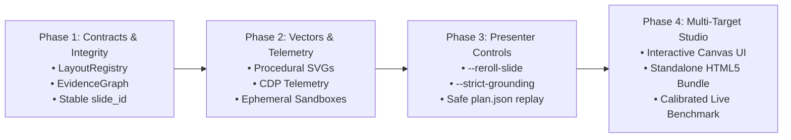

# Unified Presentation Agency Architecture Blueprint

> **Status**: Approved by Swarm Consensus (`senior-ai-dev`, `senior-designer`, `ai-designer`, `user-advocate`)  
> **Date**: 24 November 2026  
> **Target Revision**: Post-`a4f7138`  
> **Cross-References**: [Engineering Review #03](../reviews/03_project_review.md) · [Technical Findings](../reviews/code/03_technical_findings.md) · [Verification Record](../reviews/03_verification.md) · [Anti-"AI Slop" Visual Blueprint](../ai_slop_improvement_plan.md)

---

## 1. Executive Mandate: Factual Truth over Visual Illusion

A rigorous synthesis across **Architectural Review #01**, **Release Review #02**, and **Senior Staff Review #03** crystallized the foundational reality of autonomous presentation generation:

> **The primary failure mode of AI presentation systems is not lack of aesthetic variety; it is the silent erosion of factual trust.**
>
> A business presenter, executive, or technical lead can tolerate a simple card layout. What they **cannot** tolerate is:
> 1. An automated fallback or template inventing business metrics (`$12M`, `3.5x`, `92%`, `25%`, `+12% YoY`).
> 2. An authoritative footnote linking to an unrelated article with mismatched data.
> 3. An internal speaker note leaking onto the visible slide canvas (`{{ slide.speaker_notes[:140] }}`).
> 4. Slide 2's editable text rendered over Slide 3's background plate because array indices drifted after a single error.

This blueprint codifies the unified technical, visual design, generative AI, and end-user architecture to ensure `ai-ppt-maker` delivers studio-grade visual quality **while guaranteeing 100% factual and operational reliability**.

---

## 2. Four Real-World Presenter Scenarios & Failure Analysis

```
┌────────────────────────────────────────────────────────────────────────┐
│ FOUR PRESENTATION USE CASES                                            │
├────────────────────┬────────────────────┬──────────────────────────────┤
│ 1. Executive Board │ 2. VC Pitch Deck   │ 3. Architecture Briefing     │
│ • CFO / CEO        │ • Startup Founder  │ • Principal Systems Engineer │
│ • Strict metrics   │ • High drama, Hero │ • Sequence & process ribbons │
│ • 0% hallucination │ • Editable PPTX    │ • Note confidentiality       │
├────────────────────┴────────────────────┴──────────────────────────────┤
│ 4. Equity Research Briefing                                            │
│ • Market Research Analyst                                              │
│ • 1:1 Claim-to-Evidence citations with clickable links                 │
└────────────────────────────────────────────────────────────────────────┘
```

### Scenario 1: Executive Presenting Q3 Board Numbers
- **Real-World Reality**: The CFO and CEO are presenting financial performance to audit committees and institutional investors. A single hallucinated number or misattributed metric can trigger regulatory penalties or destroy executive credibility.
- **Vulnerabilities Uncovered in Review #03**:
  1. *Fallback Metric Invention*: When staged multi-agent generation triggered recovery, fallback logic fabricated `$12M`, `3.5x`, `92%`, and `98%` out of thin air (`fallback.py:124`).
  2. *Template Metric Invention*: When rendering a legacy KPI slide from text bullets, Jinja templates calculated `{{ loop.index * 25 }}%` and `+{{ loop.index * 12 }}% YoY` without any model or source input (`kpi_dashboard.html:123`).
  3. *Index Shift Horrors*: Missing a middle slide caused subsequent slides to shift array indices in PPTX export (`pptx_exporter.py:203`), placing revenue numbers over customer churn charts.
- **Architectural Remedy**: Strict `EvidenceGraph` foreign keys for all quantitative numbers, mandatory `MissingEvidencePolicy.ABSTAIN`, and stable UUID-pinned slide identities (`slide_id`).

### Scenario 2: Startup Founder Delivering a VC Pitch
- **Real-World Reality**: The founder has 3 minutes to capture partner attention. They need extreme visual contrast: bold 92pt hero statements, expansive negative space, and punchy value propositions. When follow-up PPTX files are sent, partners open them natively on iPads and MacBooks.
- **Vulnerabilities Uncovered in Review #03**:
  1. *Hero Statement Export Crash*: A standard Hero Statement with a subtitle crashed PPTX export with `KeyError: 'body'` (`pptx_exporter.py:303`).
  2. *Silent Data Deletion*: A valid Hero Statement block holding `47%` completely disappeared from both PDF and PPTX because the template silently ignored typed content (`hero_statement.html:99`).
  3. *Illegible AI Slop*: Extracted Slidesgo background assets placed high-detail phone mockups and letters directly beneath text, destroying contrast.
- **Architectural Remedy**: Declarative `LayoutRegistry` binding all slots and font roles, pure dual-layer plate separation (`.slide-content { visibility: hidden }` during raster capture), and the **5% Contrast Rule** for atmospheric surfaces.

### Scenario 3: Technical Lead Briefing Engineering Architecture
- **Real-World Reality**: A Principal Architect is briefing 80 engineers on a multi-region Kubernetes migration, relying on sequence ribbons, step timelines, and code callouts.
- **Vulnerabilities Uncovered in Review #03**:
  1. *Late-Source Blindness*: Staged multi-agent planning truncated inputs at character 4,000 (`stages.py:240`), dropping architectural details near the end of documents.
  2. *Private Note Leakage*: Templates leaked internal speaker delivery instructions into visible slide copy (`bento.html:194, 287`, `creative.html:129`, `modern_tech.html:127`, `editorial.html:132`).
  3. *Forced Marketing Clichés*: Forcing assertive takeaway headlines on technical topology slides created clumsy marketing slogans instead of technical precision.
- **Architectural Remedy**: Full-document chunking and evidence mining, sealed template boundaries guaranteeing 100% note confidentiality, layout-specific slot budgets, and **Dual-Mode Titling** (`assertive_takeaway` vs. `structural_descriptive`).

### Scenario 4: Research Analyst Briefing on Market Data
- **Real-World Reality**: An equity analyst briefing institutional clients requires strict evidentiary auditability. Every assertion must map directly to an authoritative cited source with clickable hyperlinks.
- **Vulnerabilities Uncovered in Review #03**:
  1. *Positional Citation Corruption*: Sources about 10 and 70 units were mapped to a claim about 14 units purely due to `(idx * 2) % len(cits)` array distribution (`cli.py:397`).
  2. *Link Stripping*: While PDF kept citations as clickable links, PPTX stripped 100% of hyperlinks and badge text.
  3. *Reverse Split Layout Divergence*: Chromium flipped text/image columns, but PPTX kept coordinates fixed at 0.8" from left, piling text directly over visual elements.
- **Architectural Remedy**: 1:1 Claim-to-Evidence bindings, Playwright CDP coordinate telemetry (`[data-pptx-target]`), and native OOXML hyperlink text boxes in PowerPoint export.

---

## 3. The 5 Core Architectural Pillars

```
                                  AI-PPT-MAKER 5.0 CORE
                                             │
      ┌──────────────────┬───────────────────┼───────────────────┬──────────────────┐
      ▼                  ▼                   ▼                   ▼                  ▼
   Pillar 1           Pillar 2            Pillar 3            Pillar 4           Pillar 5
Unified Layout    Grounded Evidence     Human Visual       Procedural SVG     Stable Identity
   Registry             Graph           Craft & Tone          Textures         & Run Sandbox
```

### Pillar 1: Declarative `LayoutRegistry` & Adaptive Slot Budgets
Eliminates the "8-file layout tax" by consolidating layout definitions, slot budgets, template paths, and coordinate mappings into a single source of truth.

```python
@dataclass(frozen=True)
class LayoutSlot:
    slot_id: str
    display_name: str
    max_chars: int
    max_words: Optional[int] = None
    required: bool = False
    pptx_box: Tuple[float, float, float, float] = ()  # Default (L, T, W, H) in inches
    font_role: str = 'body'                           # Maps to typography scale token

@dataclass(frozen=True)
class LayoutSpec:
    layout_id: str
    display_name: str
    description: str                                  # Injected into AI Architect & Synthesis prompts
    template_file: str                                # e.g. "bento.html", "split.html"
    supported_variants: Tuple[str, ...] = ()          # e.g. ('default', 'reverse')
    supported_blocks: Tuple[str, ...] = ()            # e.g. ('BentoBlock', 'StatBlock')
    slots: Dict[str, LayoutSlot] = field(default_factory=dict)
    requires_image: bool = False
    supports_pptx_overlay: bool = True
```

- **Adaptive Slot Budgets**:
  - `hero_statement`: Title $\le$ 65 chars (clamp 64–92pt), Subtitle $\le$ 120 chars (24–28pt), 0 bullets.
  - `split`: Title $\le$ 55 chars, Subtitle $\le$ 90 chars, Content $\le$ 70 words, 1 Hero Image (58% width).
  - `bento_8_4`: Hero Card Title $\le$ 45 chars, Hero Body $\le$ 140 chars; Micro Cards Metric $\le$ 12 chars, Label $\le$ 30 chars, Body $\le$ 75 chars.
  - `roadmap_chain`: 3–5 nodes, step titles $\le$ 35 chars, descriptions $\le$ 65 chars.
- **Single Source of Truth**: Prompts, Pydantic validation, Jinja dispatch, and PPTX coordinate resolution query `LayoutRegistry.get(layout_id)`. Adding a layout touches exactly 2 files: 1 registry declaration + 1 Jinja template.

---

### Pillar 2: Grounded `EvidenceGraph` & Zero-Hallucination Fallback
Guarantees that every quantitative assertion is bound to verified source facts, completely banning synthetic fallback metrics.

```python
class EvidenceItem(BaseModel):
    evidence_id: str = Field(description="Unique hash or slug, e.g. ev_q3_arr_01")
    source_url: str
    source_title: str
    domain: str
    raw_snippet: str
    extracted_claims: List[str]

class MetricBinding(BaseModel):
    raw_value: str                        # e.g. "$14.2M"
    numeric_val: Optional[float]
    unit: str                             # e.g. "USD", "%"
    evidence_id: str                      # REQUIRED foreign key to EvidenceItem
    is_assumption: bool = False           # Explicit tag if user-estimated
```

- **Zero-Hallucination Fallback Contract**:
  - If generation fails or lacks supporting evidence for numeric blocks (`stat`, `kpi_dashboard`), the fallback **CANNOT** invent numbers.
  - It dynamically morphs to qualitative insight cards (`editorial` / `takeaway`) or renders an unquantified structural state.
  - Missing facts trigger `MissingEvidencePolicy.ABSTAIN` with an explicit audit diagnostic.
- **Claim-Level Citation Binding**: Citations are matched via semantic keyword and claim overlap (`slide_words & cit_words`), eliminating arbitrary modulo-2 positional distribution.

---

### Pillar 3: Human Visual Craft & Dual-Mode Titling
Transforms decks from generic wireframes into studio-grade visual narratives matching Pitch.com and Duarte standards.

- **Extreme Typographic Scale Contrast**:
  - Hero Display: 92–110pt (Space Grotesk / Playfair Display / Instrument Serif)
  - Slide Headline: 42–48pt (Tight leading 1.12, tracking -0.02em)
  - Tracked Uppercase Eyebrows: 12–13pt (+0.14em tracking, 700 weight, `var(--primary)`)
  - Background Sequence Watermarks: 240–320pt digits (`01`, `02`) at 3.5% opacity
- **Dual-Mode Titling**:
  1. `assertive_takeaway` (Default for Pitch Decks, Executive Reviews, Keynotes):
     - Follows the Duarte/McKinsey rule: states the verdict, not the topic (*"Enterprise NDR Reached 134% as Churn Dropped Below 2%"*).
  2. `structural_descriptive` (For Financial Statements, Compliance, System Topologies):
     - Two-part anchor: `[Category Eyebrow] + [Explicit Operational Scope]` (*"Consolidated Balance Sheet as of Sept 30, 2026"*).
     - Single-word passive headings (*"Overview"*, *"Architecture"*) remain strictly prohibited.

---

### Pillar 4: Pure Procedural SVG Textures & The 5% Contrast Rule
Completely eliminates the P0 legal and licensing risk of distributing extracted Slidesgo assets, while guaranteeing crystal-clear legibility.

- **The 5% Contrast Rule**: Textures must be non-semantic, continuous, and quiet (2–4% opacity), never overpowering foreground text.
- **Glassmorphic Scrims**: Content cards floating over atmospheric surfaces require high-opacity backings (`rgba(var(--surface-card-rgb), 0.94)` with `backdrop-filter: blur(24px)`), guaranteeing WCAG AAA contrast ($\ge 7:1$ for body text).
- **Procedural SVG Texture Engine**: Replaces 179 proprietary Slidesgo JPGs/PNGs with pure mathematical SVGs:
  1. `WatercolorTexture`: Fractal noise + diffuse lighting SVG filter (`feTurbulence` + `feDiffuseLighting`).
  2. `TechDotGridTexture`: Scalable 48px vector matrix with micro-dots.
  3. `ModernProposalGrid`: Isometric hairline grid with 3% primary-accent strokes.
  4. `AestheticRetroHalftone`: Mathematical dot-screen radial falloff.
- **Benefits**: 100% legal clean-room code, zero wheel bloat (drops package from 85MB to <2MB), dynamic CSS variable binding, and infinite DPI vector PDF printing.

---

### Pillar 5: Stable Identity, Ephemeral Sandbox & Telemetry Alignment
Guarantees thread-safe execution, prevents array index shifting, and achieves sub-pixel alignment between Vector PDF and Editable PowerPoint.

- **Immutable `slide_id: UUID`**:
  - Slides are pinned to `slide_id = f"sld_{uuid4().hex[:8]}"` at inception.
  - Display reordering modifies `display_index`, but HTML, PNG background plates, and PPTX overlays remain strictly joined by `slide_id`.
  - Missing slide IDs trigger an atomic pipeline exception, never an array shift.
- **Ephemeral Run Sandbox**:
  ```
  runs/<run_id>/
    ├── run_manifest.json       # Effective configuration, seeds, checksums
    ├── master_plan.json        # Validated MasterPlan pinned to run
    ├── html/                   # slide_{slide_id}.html
    ├── pdf/                    # slide_{slide_id}.pdf
    ├── plates/                 # slide_{slide_id}_bg.png (pure backgrounds)
    ├── diagnostics/            # dom_audit.json, refiner_trace.json
    └── output/                 # presentation.pdf, presentation.pptx, speaker_notes.md
  ```
- **Playwright CDP Bounding-Box Telemetry Protocol (`[data-pptx-target]`)**:
  - During the Chromium render pass, Playwright queries `document.querySelectorAll('[data-pptx-target]')` and measures actual browser bounding boxes (`r.left / 144`, `r.top / 144` in inches).
  - `PptxExporter` overlays native text boxes at the exact browser-measured bounds, natively supporting Reverse Split (`left: 8.22"`) and custom bento shapes with sub-pixel alignment.
- **Pure Dual-Layer Plate Separation**:
  - In `renderer.render_background_only()`, text is hidden via `.slide-content { visibility: hidden }`.
  - Background plates contain only gradients, ambient lighting, and FLUX artwork.
  - Native PowerPoint text frames overlay cleanly on top with **zero double-text artifacts**.

---

## 4. Four Critical Presenter Controls

To deliver a reliable enterprise tool, the CLI and API must expose four explicit user controls:

1. **Instant 3-Slide Preview (`--preview`)**:
   - Slices `master_plan.slides[:3]` *before* image generation, templating, or rendering.
   - Enforces 16:9 (`960x540`) viewport geometry, completing in <3 seconds without wasting API tokens.
2. **Single-Slide Re-Roll (`--reroll-slide <slide_id|number>`)**:
   - Surgically re-generates or re-themes a single slide without modifying or re-spending tokens on the other 9 slides.
3. **Deterministic Plan Inspection & Replay (`plan.json`)**:
   - Presenter runs `--plan-only`, opens `plan.json`, edits copy or metrics manually, and runs `generate --offline-plan plan.json`.
   - Guaranteed 100% fidelity: the engine renders exact user edits without model re-interpretation.
4. **Enterprise Strict Grounding Mode (`--strict-grounding`)**:
   - Boardroom compliance toggle: fails validation if any quantitative metric lacks a verified `evidence_id`.

---

## 5. Phased Implementation Roadmap



| Phase | Milestone | Key Deliverables | Verification Gates |
|---|---|---|---|
| **Phase 1** | **Contracts & Integrity** | • Build `ppt_maker/design/layout_registry.py`<br>• Implement `EvidenceGraph` in `ppt_maker/core/evidence.py`<br>• Pin `Slide.slide_id: UUID` in `schemas.py` | • 0 missing layout references across 8 files<br>• 0 ungrounded metrics in fallbacks<br>• Unit tests pass with UUID joins |
| **Phase 2** | **Vectors & Telemetry** | • Procedural SVG texture macros in `templates/_textures.html`<br>• CDP `[data-pptx-target]` telemetry in `renderer.py`<br>• Purge 179 proprietary raster assets from wheel | • Package wheel size <2MB<br>• Reverse split text aligns sub-pixel in PPTX<br>• Zero double-text artifacts |
| **Phase 3** | **Presenter Controls** | • Fast `--preview` (<3s, 16:9)<br>• Surgical `--reroll-slide`<br>• Deterministic `--offline-plan` replay<br>• `--strict-grounding` validation flag | • Preview yields exactly 3 complete pages<br>• Manual `plan.json` edits preserved 100%<br>• Strict grounding catches unverified claims |
| **Phase 4** | **Multi-Target Studio** | • Interactive Web / MCP App Canvas<br>• Standalone HTML5 Reveal.js bundle with Presenter Mode<br>• Paired live-model benchmark rig | • Instant browser canvas slide inspector<br>• Offline presenter display with dual-screen notes<br>• Benchmark measures real DOM & token spend |

---

## 6. Document Revision & Indexing

- **Index Reference**: Added to [docs/README.md](../README.md).
- **Approved By**: Swarm Consensus (#42, #43, #44, #45, #46, #47, #48).
- **Next Action**: Execute Phase 1 implementation (`LayoutRegistry` and `EvidenceGraph`).
